# Segunda auditoria de UI/UX antes do TCC

Data: 27/10/2026 · Branch auditada: `main` em `d6fc2f5` (com a fase 2 inteira: #84 a #90) · Só leitura: nenhum código mudou.

20 achados novos: 2 críticos, 8 importantes e 10 de polimento. Nenhum pede redesign; todos ficam dentro da identidade atual. O que a primeira auditoria (`2026-10-auditoria-tcc.md`) já decidiu (`2026-10-auditoria-tcc-decisoes.md`) não voltou como achado.

## Como ler

- **Severidade.** *Crítico*: a banca nota em segundos, no cenário da apresentação (projetor em 150%). *Importante*: aparece num fluxo normal. *Polimento*: detalhe que uma banca atenta aponta.
- **Rota.** *direto*: corrigir sem explorar o visual (decidi por você). *designer decide*: escolha de gosto ou de identidade, trazida com uma recomendação.
- **Esforço.** P: até meia hora. M: algumas horas.
- **Onde.** Caminhos relativos a `System_X_System_React/`. Nenhuma correção mexe na zona pixel-tuned de `src/components/CLAUDE.md` nem pede cor nova na palette.

## Como foi explorado

- `main` local na 5173 (Vite), API na 5000 e jogo na 8081. Chrome headless pelo DevTools Protocol, com perfil próprio e contexto isolado por conta: as abas abertas no seu navegador não foram tocadas.
- **27 telas × 9 larguras** (320, 390, 768, 853 a 1,5× de densidade, que é o projetor em 150%, 1024, 1280, 1366, 1440 e 1920), 243 capturas. Em cada uma, por script: texto cortado, texto fora da tela, rolagem horizontal, fonte de cada texto, textos abaixo de 12 px e erros de console.
- Contas: `test@` (mestre das campanhas de teste) e `test2@` (jogador) nas telas sem socket, com o socket desligado na página; lobby e mesa só com `mestre@seed.dev` e `jogador1@seed.dev`, os dois abertos ao mesmo tempo para ver a visão do jogador com a sala aberta.
- Estados forçados interceptando a API: carregando (requisição pendurada), erro (500), lista vazia; login com campo vazio, senha errada e servidor demorando; calendário aberto; menu Gerenciar aberto.
- Contraste medido pela cor do texto contra a cor real do fundo (pixels do print quando o fundo é imagem).

**Resultado limpo — a fase 2 funcionou:**
- Nenhum texto cortado nem fora da tela, nenhuma rolagem horizontal, em nenhuma das 243 telas. O único “corte” que o script acusa é a descrição longa da campanha, que é o recolhido de propósito (com a seta para expandir).
- Todo texto em Roboto, sem nenhuma serifada.
- Nenhum erro de console.
- Os estados de carregando, erro, 404 e vazio aparecem com o fundo da família certa (mapa ou espaço), cabeçalho e saída.
- Login e cadastro: foco, erro por campo, “E-mail ou senha incorretos.”, botão ocupado e o aviso do servidor acordando, todos funcionando.
- Menu Gerenciar, “?” das ações indisponíveis, selos e cabeçalhos de campanha, partida e lobby: sem sobreposição em nenhuma largura.

**O que não foi verificado:**
- Tablet e celular físicos: as larguras foram simuladas.
- O texto “Toque/Clique” das dicas da mesa: o headless não tem mouse, então sempre mostra “Toque”. O código usa `(pointer: fine)`, que num computador real mostra “Clique”. Não é achado.
- Um turno de combate jogado: a primeira auditoria já cobriu, e a fase 2 não mexeu no fluxo da mesa.

## Resumo

| Id | Achado | Severidade | Rota | Esforço |
|---|---|---|---|---|
| EDI-03 | Editor de mapa: o painel da ferramenta some em tela baixa | Crítico | direto | M |
| LOB-01 | Lobby: o painel de NPCs espreme o tabuleiro | Crítico | direto | M |
| FOR-07 | Calendário passa da borda de baixo no projetor | Importante | direto | P |
| HIER-01 | Celular: título da página menor que os rótulos e o subtítulo | Importante | direto | P |
| RES-03 | Card de partida: título com uma palavra por linha no celular | Importante | direto | P |
| CON-09 | Gerenciar e a ação principal mudam de formato entre telas | Importante | direto | P |
| COR-08 | Aba inativa (“Mapas”) com contraste 2,1:1 | Importante | direto | P |
| LOB-02 | Lobby: vão de 137 px e tabuleiro aberto sem enquadrar | Importante | direto | P |
| IDENT-01 | Login e cadastro: os campos perderam o traço do projeto | Importante | designer decide | P |
| FOR-09 | Ficha: nome completo e descrição sem rótulo | Importante | direto | P |
| TIP-03 | Texto de duas linhas sem entrelinha | Polimento | direto | P |
| EST-06 | Lista vazia no celular: mensagem colada na borda | Polimento | direto | P |
| EST-07 | Aviso “o lobby ainda não foi aberto” igual a uma descrição | Polimento | direto | P |
| MESA-07 | Mesa do jogador: aviso do tabuleiro encosta nas bordas | Polimento | direto | P |
| FOR-08 | Login em 320 px: link quebrado e alinhado à esquerda | Polimento | direto | P |
| COR-09 | Barra de rolagem vermelha nas listas de mundo | Polimento | direto | P |
| NAV-03 | Aba “Eventos” sem nenhum evento | Polimento | designer decide | P |
| FICHA-01 | Ficha no desktop: botões flutuantes longe da ficha | Polimento | designer decide | P |
| FICHA-02 | “ATRIBUTOS” longe do diagrama | Polimento | designer decide | P |
| LOB-03 | Lobby: os botões empilhados com larguras diferentes | Polimento | direto | P |

## Achados

### Críticos

#### EDI-03 · Editor de mapa: o painel da ferramenta some em tela baixa

**Severidade:** Crítico · **Rota:** direto · **Esforço:** M
**Tela:** Criar e editar mapa · 853×533 (projetor em 150%), 320×568 e 390×844

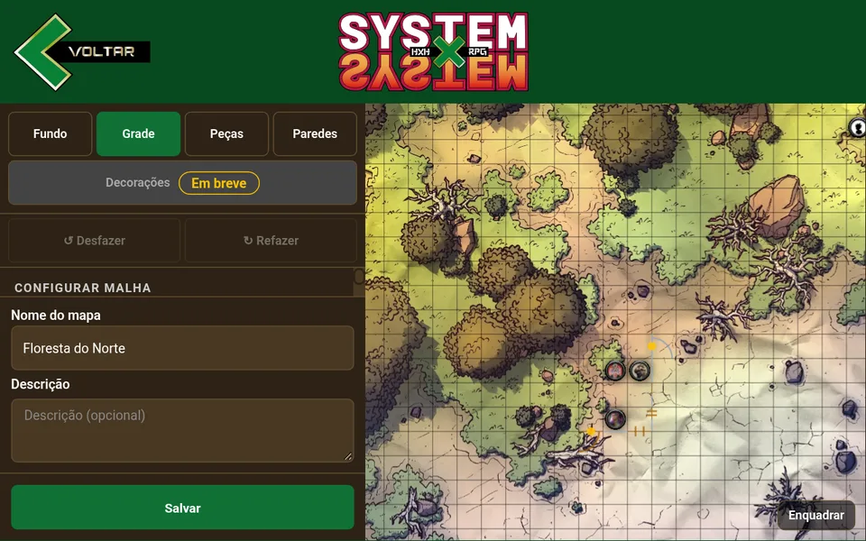
*Projetor em 150%: de “Configurar malha” só sobra o título*

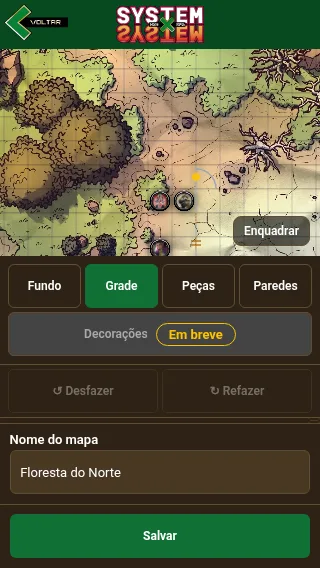
*320 px: entre Desfazer e “Nome do mapa”, nada*

**O que está errado.** A coluna do editor empilha abas, Decorações, Desfazer/Refazer, o painel da ferramenta (Grade, Fundo, Peças, Paredes), o nome, a descrição e Salvar. Só o painel da ferramenta encolhe para caber, e ele encolhe primeiro: medido, ele fica com **28 px** de altura no projetor (853×533), **4 px** em 320×568 e 155 px em 390×844. Em 1366×768 sobram 292 px. Ou seja, no projetor, quem clica em “Grade” não vê colunas, linhas, tamanho, cor nem opacidade: vê o título “CONFIGURAR MALHA” e uma barra de rolagem de 28 px.

**Por que importa.** O projetor em 150% é o cenário da apresentação. Se o editor for mostrado, a ferramenta parece não abrir.

**Causa.** A barra lateral (`Toolbar`) tem a altura da tela e `overflow: hidden`; dentro dela, só o `PanelArea` pode encolher (`flex: 1; min-height: 0`), e o bloco do nome, da descrição e do Salvar (`MetaSection`) tem altura fixa. Quanto mais baixa a tela, menos sobra para o painel. No celular, a página inteira tem a altura da tela, e a barra fica com 3/5 dela.

**Correção sugerida.** A coluna inteira rola como um bloco só (o `overflow-y: auto` sai do `PanelArea` e vai para o `Toolbar`), com o painel na altura do próprio conteúdo e o bloco do nome/Salvar depois dele. Em tela alta nada muda visualmente; em tela baixa, rola-se a coluna, e o painel nunca vira fresta. No celular, o mesmo vale para a parte de baixo da tela.

**Onde:** `src/features/tactical-map/MapEditorToolbar.tsx:312-392` (`Toolbar`, `PanelArea`, `MetaSection`); `src/components/templates/MapEditorTemplate.tsx` (`Sidebar` no celular)

#### LOB-01 · Lobby: o painel de NPCs espreme o tabuleiro

**Severidade:** Crítico · **Rota:** direto · **Esforço:** M
**Tela:** Lobby do mestre · 853 (projetor), 768, 390 e 320 px

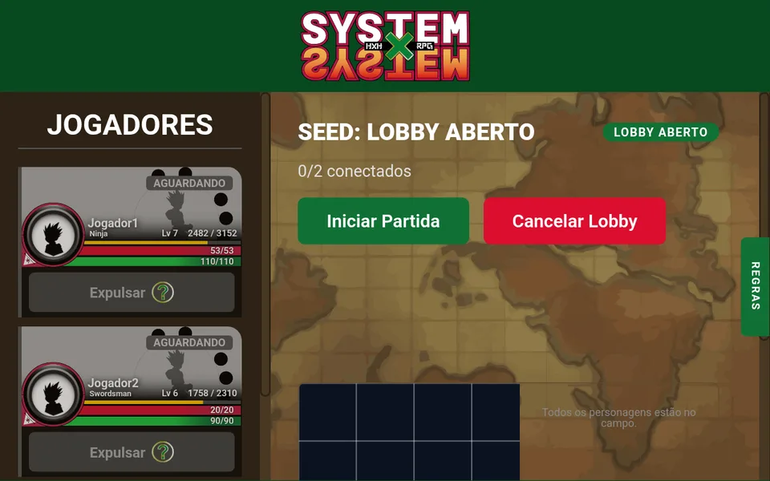
*Projetor em 150%: o tabuleiro com 245 px de largura, embaixo da dobra*

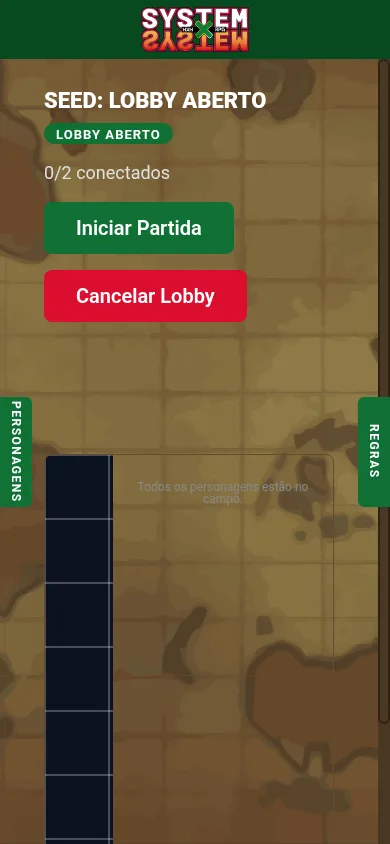
*390 px: uma fresta de tabuleiro de 65 px*

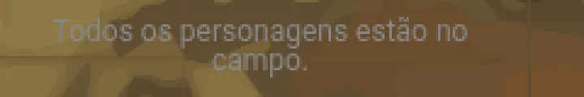
*O aviso do painel, ampliado 3×: cinza sobre o mapa*

**O que está errado.** No lobby, o painel de NPCs fica à direita do tabuleiro com **220 px fixos**. A coluna central encolhe com a tela, o painel não: o tabuleiro fica com ~245 px no projetor, ~160 px em 768 e ~65 px em 390. Além disso, o painel não tem fundo: o aviso “Todos os personagens estão no campo.” fica em cinza de 12 px direto sobre o mapa-múndi, com contraste de cerca de 1,3:1. Na mesa o mesmo painel fica sobre fundo escuro e se lê bem; o problema é só no lobby.

**Por que importa.** O lobby é onde o mestre arruma as peças antes de começar. No projetor, a banca veria uma tira do tabuleiro e um texto que ninguém lê.

**Correção sugerida.** O painel vira uma faixa **embaixo** do tabuleiro quando a coluna central for estreita (container query na seção do mapa, algo como abaixo de 640 px), e mantém os 220 px à direita só quando sobra espaço. O painel ganha o fundo das colunas laterais (`surfaceSidebar`, o marrom escuro de Personagens e Regras), para o aviso e a busca ficarem legíveis sobre qualquer fundo.

**Onde:** `src/features/tactical-map/TacticalMapPlacer.tsx:281-300` (`PlacerRoot`, `RosterSidebar` com `width: 220px`); `src/components/molecules/NpcRosterPanel.tsx:148-153` (`EmptyHint`)

### Importantes

#### FOR-07 · Calendário passa da borda de baixo no projetor

**Severidade:** Importante · **Rota:** direto · **Esforço:** P
**Tela:** Criar e editar partida (data e hora da sessão) e campanha · 853×533 (projetor)

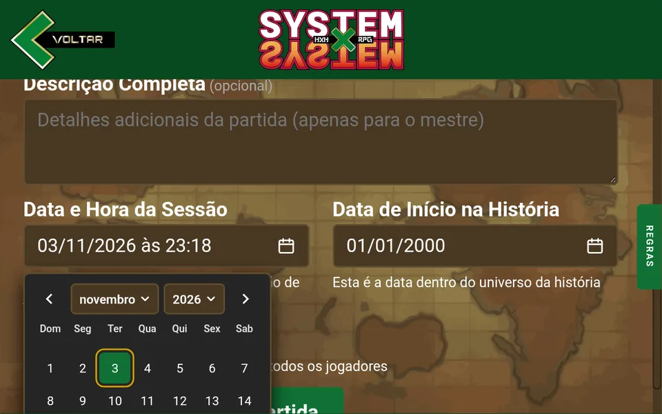
*Projetor: o calendário abre para baixo e o fim dele fica fora da tela*

**O que está errado.** O seletor de data novo tem 431 px de altura (com hora e minuto). Em 853×533 não cabe nem acima nem abaixo do campo; ele abre para baixo e vai até 782 px numa tela de 533. Como é `position: fixed`, rolar a página não ajuda: as últimas semanas, os seletores de hora e minuto e o “Limpar” ficam inalcançáveis. No celular (390×844) ele abre para cima e cabe.

**Por que importa.** Criar uma partida ao vivo no projetor é uma demonstração provável, e a hora da sessão fica impossível de escolher.

**Correção sugerida.** Quando não couber em nenhum dos lados, prender o calendário dentro da janela (`top = max(8, innerHeight - altura - 8)`, cobrindo o campo) e, como garantia, `max-height: calc(100dvh - 16px)` com rolagem interna. A regra de “abrir para cima se não couber embaixo” continua valendo quando um dos lados cabe.

**Onde:** `src/components/molecules/DateField.tsx` (posição do popover)

#### HIER-01 · Celular: título da página menor que os rótulos e o subtítulo

**Severidade:** Importante · **Rota:** direto · **Esforço:** P
**Tela:** Criar/editar campanha e partida (320–768 px); campanha e partida (320–390 px)

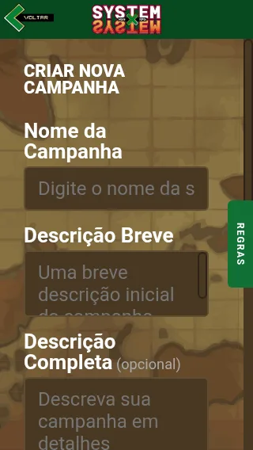
*Formulário em 320 px: “Nome da Campanha” (26 px) maior que o título (22 px), e o exemplo do campo cortado*

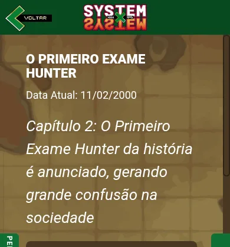
*Campanha em 390 px: o subtítulo em itálico (26 px) maior que o título (22 px)*

**O que está errado.** O título da página encolhe com a tela (40 px no desktop, 22 px em 320), mas os rótulos dos formulários ficam fixos em 26 px e os campos em 24 px. Em 320 px o rótulo “Nome da Campanha” fica maior que o título “CRIAR NOVA CAMPANHA”; os campos ficam tão grandes que o exemplo dentro deles corta (“Digite o nome da s”, “Digite o título da pa”) e o exemplo da descrição breve passa da caixa. Na campanha e na partida, o subtítulo em itálico continua com 26 px enquanto o título cai para 22 px: em 320 px o subtítulo ocupa cinco linhas e é o que mais chama atenção na tela.

**Por que importa.** A hierarquia diz o que ler primeiro. No celular ela fica de cabeça para baixo, e o formulário vira uma rolagem longa de rótulos enormes.

**Correção sugerida.** Rótulos, campos e subtítulo acompanham a largura, como o título já faz: rótulo `clamp(18px, 5cqi, 26px)`, texto do campo `clamp(16px, 4.5cqi, 24px)` (16 px é o mínimo para o iOS não dar zoom ao focar), subtítulo `clamp(18px, 5cqi, 26px)`. No desktop nada muda (o teto é o valor de hoje). Para os exemplos, encurtar onde ainda cortarem: “Nome da campanha”, “Título da partida”.

**Onde:** `src/components/molecules/FormField.tsx` (rótulo); `src/components/ions/FormInput.tsx` e `FormTextArea.tsx`; o subtítulo em `src/pages/CampaignPage.tsx:217` e `src/features/match/MatchHeaderSection.tsx`

#### RES-03 · Card de partida: título com uma palavra por linha no celular

**Severidade:** Importante · **Rota:** direto · **Esforço:** P
**Tela:** Campanha, aba Partidas · 320 e 390 px

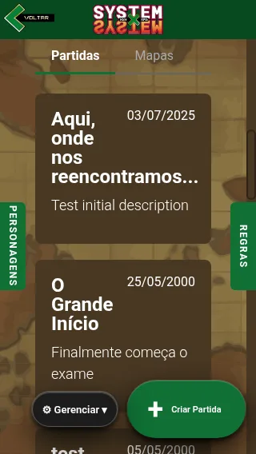
*320 px: “Aqui, / onde / nos / reencontramos...” ao lado da data*

**O que está errado.** O cabeçalho da página foi corrigido no RES-01, mas o card de cada partida na lista tem o mesmo desenho antigo: título e data lado a lado, sempre. Em 320 px a data come metade do card e o título vira uma palavra por linha (“O / Grande / Início”).

**Por que importa.** É o mesmo defeito do RES-01, que foi crítico, numa tela vizinha. A lista de partidas é a primeira coisa abaixo da descrição da campanha.

**Correção sugerida.** Container query no card: abaixo de ~360 px de largura do card, a data desce para baixo do título, encostada à esquerda (como a data do cabeçalho na Task 13 da fase 2). O título mantém o tamanho.

**Onde:** `src/features/campaign/MatchItem.tsx`

#### CON-09 · Gerenciar e a ação principal mudam de formato entre telas

**Severidade:** Importante · **Rota:** direto · **Esforço:** P
**Tela:** Campanha e partida · todas as larguras

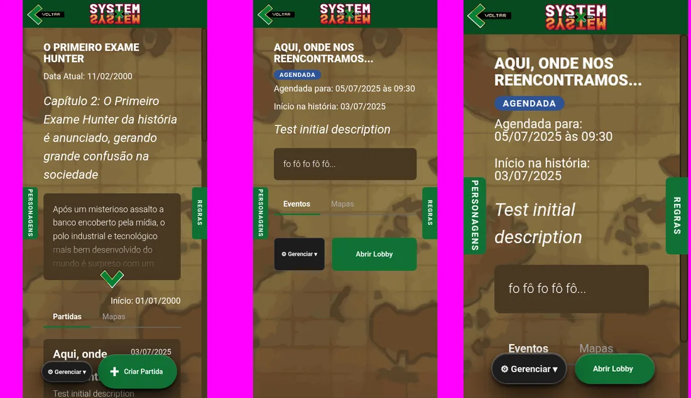
*Da esquerda para a direita: campanha em 390 (pílulas), partida em 390 (blocos de 70 px com texto de 12 px), partida em 320 (pílulas)*

**O que está errado.** O par “Gerenciar” + ação principal (“Criar Partida”, “Abrir Lobby”, “Entrar na partida”) tem dois desenhos: quando flutua, é uma pílula arredondada de 44–72 px de altura; quando fica no fluxo da página (página curta), vira um bloco quadrado de 70 px (390), 91 px (768) ou 90 px (1440) de altura, com o texto do Gerenciar em 12 px no celular. Na mesma largura, a campanha mostra pílulas e a partida mostra blocos; a mesma partida mostra pílulas em 320 e blocos em 390.

**Por que importa.** O mesmo botão com duas caras parece dois componentes. Os blocos altos com texto miúdo destoam do resto, e a troca acontece só porque a página ficou mais curta.

**Correção sugerida.** Um desenho só, o da pílula (o que você aprovou no CON-06, com a sombra mais forte). No modo de fluxo muda só a posição: a pílula fica no lugar dela na página, com a mesma altura e o mesmo texto. Nada de bloco de 90 px.

**Onde:** `src/components/molecules/AdaptiveActionButton.tsx`; `src/components/molecules/BottomActions.tsx`; `src/components/molecules/ManageButton.tsx`

#### COR-08 · Aba inativa (“Mapas”) com contraste 2,1:1

**Severidade:** Importante · **Rota:** direto · **Esforço:** P
**Tela:** Campanha e partida (abas Partidas/Eventos e Mapas) · todas as larguras

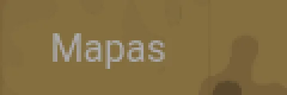
*“Mapas” ampliado 4×: cinza claro sobre o mapa*

**O que está errado.** A aba inativa usa `textPlaceholderStrong` (`#aaaaaa`) direto sobre a imagem do mapa (`#856F40` em média, ali): contraste de 2,1:1. Onde o mapa é mais claro, menos ainda.

**Por que importa.** O mínimo para texto de 16 px é 4,5:1. Quem não sabe que existe uma aba “Mapas” não a encontra; no projetor, ela some.

**Correção sugerida.** A aba inativa em `textPrimary` com peso normal (branco sobre o mapa dá 4,8:1). O que diferencia a ativa continua sendo o negrito e o sublinhado verde, que já existem. Sem token novo.

**Onde:** `src/components/organisms/PageTabNav.tsx:40-57`

#### LOB-02 · Lobby: vão de 137 px e tabuleiro aberto sem enquadrar

**Severidade:** Importante · **Rota:** direto · **Esforço:** P
**Tela:** Lobby, mestre e jogador · todas as larguras

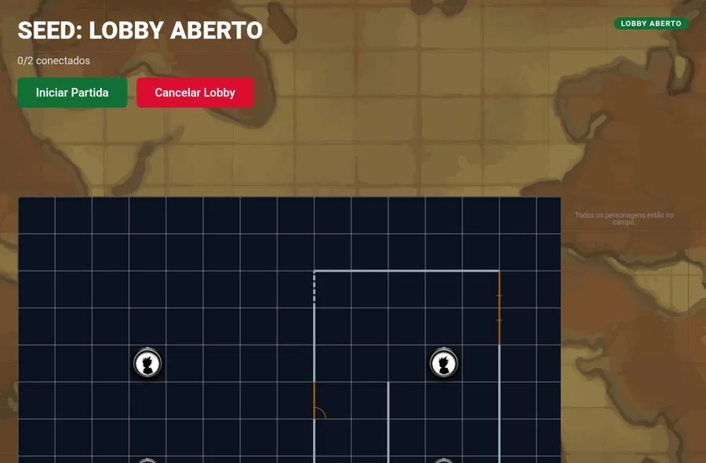
*1920 px: o vão entre os botões e o tabuleiro, e as peças cortadas na borda de baixo*

**O que está errado.** Entre “Iniciar Partida / Cancelar Lobby” (ou “Aguardando o mestre iniciar a partida…”) e o tabuleiro há ~150 px vazios. A causa: os botões do lobby estão dentro do `ActionsList`, que reserva 137 px embaixo para os botões flutuantes da campanha e da partida; no lobby os botões não flutuam. E o tabuleiro abre no canto de cima, sem enquadrar o mapa: as peças da fileira de baixo aparecem cortadas ao meio, e o lobby não tem o botão “Enquadrar” que a mesa tem.

**Por que importa.** O vão empurra o tabuleiro para baixo da dobra (no projetor ele começa na última linha visível). E um tabuleiro com peças cortadas parece quebrado.

**Correção sugerida.** No lobby, trocar o `ActionsList` por um contêiner sem a reserva (ou passar a reserva só para quem tem flutuante). Ao abrir, enquadrar o mapa inteiro, como o editor faz desde o EDI-01, e pôr o mesmo botão “Enquadrar” da mesa no canto do tabuleiro.

**Onde:** `src/components/atoms/ActionsList.tsx:4-7`; `src/pages/LobbyPage.tsx:292-312`; `src/features/tactical-map/TacticalMapPlacer.tsx`

#### IDENT-01 · Login e cadastro: os campos perderam o traço do projeto

**Severidade:** Importante · **Rota:** designer decide · **Esforço:** P
**Tela:** Login e cadastro · todas as larguras

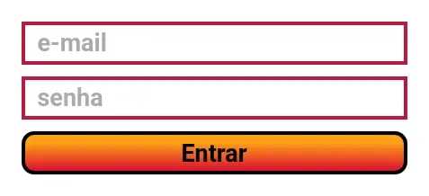
*Antes da fase 2: borda grossa vermelha, mesmo peso do botão*

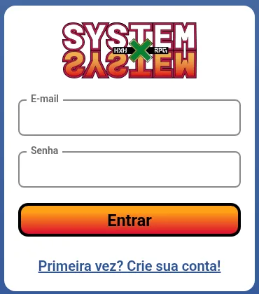
*Hoje: borda cinza de 2 px, rótulo cinza de 14 px, e o botão com contorno preto grosso*

**O que está errado.** A identidade do projeto é de traço grosso: o logo tem contorno escuro pesado e o botão “Entrar” tem contorno preto de ~4 px, cantos bem arredondados e texto em negrito. Os campos, depois da fase 2, ficaram no padrão genérico de formulário (cinza claro de 2 px, rótulo cinza fino, foco azul): corretos, mas de outro sistema visual. É por isso que a tela parece “de template”. A troca do vermelho (que se confundia com erro, COR-01) foi certa; o que se perdeu foi o **peso**, não a cor.

**Por que importa.** É a primeira tela que a banca vê, e você já sentiu a diferença.

**Correção sugerida (recomendação: A).**
- **A. Traço do botão.** Borda de 3 px no mesmo quase-preto do contorno do “Entrar”, cantos iguais aos do botão, rótulo em negrito e escuro. Foco: a borda vira o azul da marca, mais o anel. Erro: vermelho, como hoje. Usa só tokens que já existem.
- **B. Traço do logo.** Borda de 3 px no vinho escuro do contorno do logo. Mais “cara de projeto”, mas volta a ficar perto do vermelho de erro, que é o que o COR-01 tirou.
- **C. Manter o cinza, só mais grosso.** Borda de 3 px cinza e rótulo em negrito. Muda pouco.

O rótulo na borda, o espaçamento igual entre campos e botão e os erros por campo continuam como estão.

**Onde:** `src/components/molecules/SignField.tsx` (`Input`, `Label`); tokens `borderInputOnLight` e `textHint`

#### FOR-09 · Ficha: nome completo e descrição sem rótulo

**Severidade:** Importante · **Rota:** direto · **Esforço:** P
**Tela:** Criar e editar ficha · todas as larguras

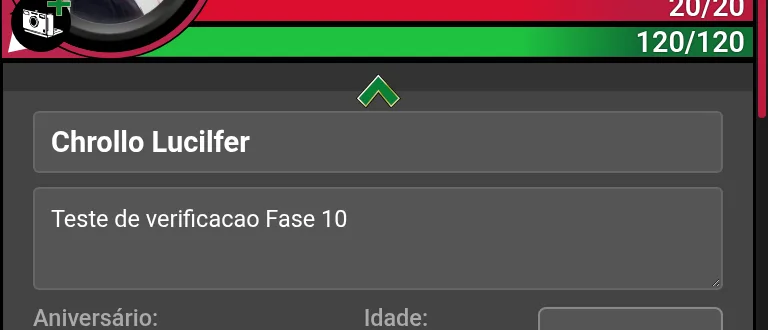
*Editar ficha: “Chrollo Lucilfer” e “Teste de verificacao Fase 10” sem dizer o que são; logo abaixo, “Aniversário:” e “Idade:” com rótulo*

**O que está errado.** No perfil da ficha, “Nome completo do personagem” e “Breve descrição do personagem” existem só como exemplo dentro do campo. Ao preencher (ou ao editar uma ficha pronta), o que o campo é desaparece. Os campos logo abaixo (Aniversário, Idade, Alinhamento) têm rótulo. O FOR-03 corrigiu isso no login e no cadastro; a ficha ficou de fora.

**Por que importa.** Na edição, a pessoa vê dois textos soltos sem saber qual é o nome e qual é a descrição. Leitor de tela também não anuncia nada.

**Correção sugerida.** Rótulos “Nome completo” e “Descrição breve” no mesmo estilo do “Aniversário:” logo abaixo (o `DetailLabel`), ligados aos campos por `htmlFor`. O exemplo dentro do campo pode ficar.

**Onde:** `src/features/sheet/ProfileInputs.tsx:65-79`

### Polimento

#### TIP-03 · Texto de duas linhas sem entrelinha

**Severidade:** Polimento · **Rota:** direto · **Esforço:** P
**Tela:** Partida (data no cabeçalho), formulários (textos de ajuda), coluna de regras (nota final)

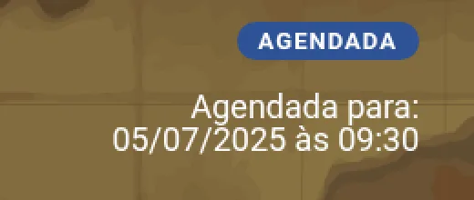
*“Agendada para: / 05/07/2025 às 09:30”, as duas linhas encostando*

*Textos de ajuda das datas, linhas coladas*

**O que está errado.** O reset global define `line-height: 1`. Todo texto corrido que quebra linha e não define a própria entrelinha fica com as linhas encostadas: a data do cabeçalho da partida quando desce para duas linhas, os textos de ajuda dos formulários (“Esta é a data e hora real em que a sessão de jogo acontecerá”, “Campanhas públicas podem ser vistas por todos os usuários”) e a nota “Mais opções de configuração serão adicionadas em breve.”.

**Por que importa.** Linhas coladas cansam a leitura e parecem desajuste.

**Correção sugerida.** `line-height: 1.35` nesses textos corridos, componente a componente (ajuda do `FormField`, `headerDate`, a nota do `UpcomingRulesSidebar`). Não mexer no reset global: ele sustenta as alturas medidas dos cards e da ficha.

**Onde:** `src/styles/ResetStyle.ts:37` (causa, não mexer); `src/components/molecules/FormField.tsx`; `src/styles/pageHeader.ts` (`headerDate`); `src/components/organisms/UpcomingRulesSidebar.tsx`

#### EST-06 · Lista vazia no celular: mensagem colada na borda

**Severidade:** Polimento · **Rota:** direto · **Esforço:** P
**Tela:** Campanhas sem nenhuma campanha · 390 px

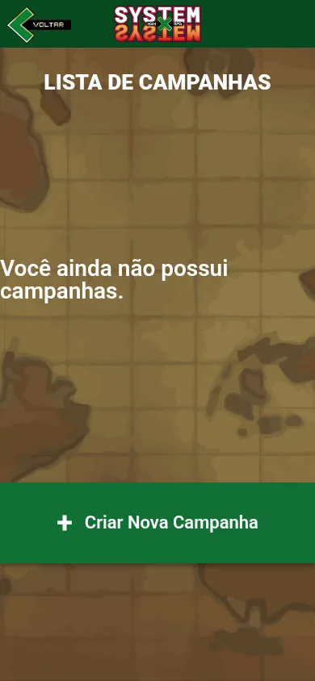
*390 px: “Você ainda não possui campanhas.” encostado na borda esquerda, título centralizado acima*

**O que está errado.** O `EmptyState` não tem margem lateral nem centralização do texto. No desktop a frase cabe numa linha e parece centralizada; no celular ela quebra, fica alinhada à esquerda e colada na borda da tela, com 28 px.

**Por que importa.** É a primeira tela de quem acabou de criar a conta.

**Correção sugerida.** `text-align: center`, `padding: 0 24px` e fonte `clamp(20px, 6vw, 28px)` no `EmptyState`.

**Onde:** `src/components/molecules/EmptyState.tsx:17-30`

#### EST-07 · Aviso “o lobby ainda não foi aberto” igual a uma descrição

**Severidade:** Polimento · **Rota:** direto · **Esforço:** P
**Tela:** Partida, para o jogador que tentou entrar no lobby fechado

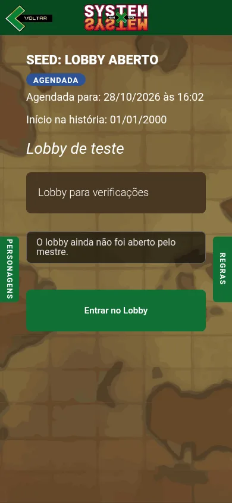
*390 px: a caixa “Lobby para verificações” (descrição) e a caixa do aviso, iguais*

**O que está errado.** O aviso “O lobby ainda não foi aberto pelo mestre.” usa a mesma caixa marrom da descrição da partida, logo acima. Não parece um aviso: parece mais um parágrafo da partida.

**Por que importa.** O jogador clicou num botão e foi devolvido; o aviso é a resposta, e precisa ser lido como tal.

**Correção sugerida.** O desenho do aviso do login (`SignNotice`: ícone e borda à esquerda), adaptado ao fundo escuro com o dourado de destaque que já existe (`actionHighlight`). Sem token novo.

**Onde:** `src/features/match/MatchHeaderSection.tsx:92-95`

#### MESA-07 · Mesa do jogador: aviso do tabuleiro encosta nas bordas

**Severidade:** Polimento · **Rota:** direto · **Esforço:** P
**Tela:** Mesa do jogador e lobby, enquanto o tabuleiro não chegou · 320 e 390 px

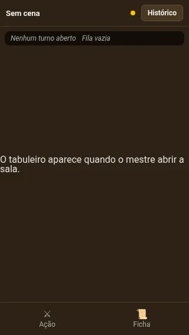
*320 px: “O tabuleiro aparece quando o mestre abrir a sala.” de borda a borda*

**O que está errado.** O aviso de espera não tem margem lateral nem centralização; quebra em duas linhas alinhadas à esquerda, coladas nas bordas. A versão de erro do mesmo aviso já tem as duas coisas.

**Por que importa.** É a tela que o jogador vê enquanto espera o mestre: no celular, ela parece desmontada.

**Correção sugerida.** Mover `text-align: center` e `padding: 0 24px` do `MapErrorMessage` para o `MapLoadingMessage` (o erro herda dele).

**Onde:** `src/features/match/combat/mapCanvasStyles.ts:10-26`

#### FOR-08 · Login em 320 px: link quebrado e alinhado à esquerda

**Severidade:** Polimento · **Rota:** direto · **Esforço:** P
**Tela:** Login e cadastro · 320 px

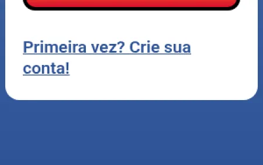
*320 px: “Primeira vez? Crie sua / conta!” alinhado à esquerda*

**O que está errado.** Em 320 px o link quebra em duas linhas e, sem `text-align`, fica alinhado à esquerda num cartão em que todo o resto é centralizado.

**Por que importa.** Detalhe pequeno, mas na primeira tela.

**Correção sugerida.** `text-align: center` no link do `SignPagesTemplate`.

**Onde:** `src/components/templates/SignPagesTemplate.tsx:46-51`

#### COR-09 · Barra de rolagem vermelha nas listas de mundo

**Severidade:** Polimento · **Rota:** direto · **Esforço:** P
**Tela:** Minhas campanhas e campanhas públicas · quando a lista rola (celular, 1024×768, projetor)

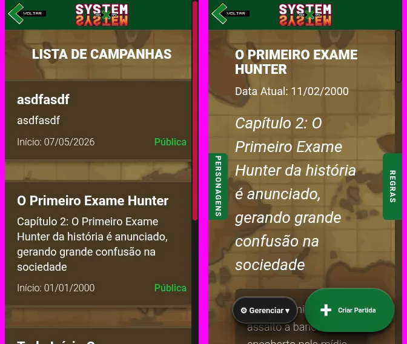
*Lista de campanhas (vermelha) e campanha (marrom), as duas sobre o mesmo mapa*

**O que está errado.** As telas de campanha, partida, formulários e editor trocam a barra de rolagem para a paleta `earth` (marrons dos painéis). As duas listas de campanhas, que usam o mesmo fundo de mapa, ficaram com a barra global vermelha, porque o `ListPageTemplate` não troca.

**Por que importa.** Duas telas da mesma família com barras diferentes; o vermelho da barra é a cor mais forte da tela.

**Correção sugerida.** O `ListPageTemplate` aplica `scopedScrollbar(scrollbarPalettes.earth)` quando o fundo é o do mapa. A lista de personagens (fundo de espaço) continua com a barra global.

**Onde:** `src/components/templates/ListPageTemplate.tsx`; `src/styles/scrollbar.ts`

#### NAV-03 · Aba “Eventos” sem nenhum evento

**Severidade:** Polimento · **Rota:** designer decide · **Esforço:** P
**Tela:** Página da partida, mestre e jogador

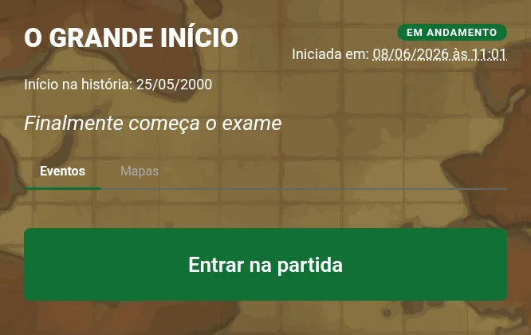
*“Eventos” ativo: embaixo, só o botão “Entrar na partida”*

**O que está errado.** A partida abre na aba “Eventos”, mas ela não lista evento nenhum: só contém os botões (Gerenciar, Abrir Lobby, Entrar). Para o jogador é a única aba, então aparece uma barra de abas com uma aba só.

> **Correção (28/10):** essa última frase está errada. A barra de abas some quando há uma aba só (`PageTabNav` retorna nada), então o jogador não vê a barra. Ele só vê abas na partida encerrada ("Eventos" e "Mapas").

**Por que importa.** A aba promete um conteúdo que não existe. Se a banca clicar em “Eventos” esperando o histórico da partida, não acha nada.

**Correção sugerida (recomendação: A).**
- **A.** Se “Eventos” é uma funcionalidade futura, mostrar ali o mesmo selo “Em breve” e uma linha (“Os eventos da partida vão aparecer aqui.”), como a coluna de Regras. Os botões continuam onde estão.
- **B.** Renomear a aba para o que ela é hoje (“Partida”) e esconder a barra quando há uma aba só (jogador).

**Onde:** `src/pages/MatchPage.tsx:160-166, 318-350`

#### FICHA-01 · Ficha no desktop: botões flutuantes longe da ficha

**Severidade:** Polimento · **Rota:** designer decide · **Esforço:** P
**Tela:** Ver ficha · 1366 e 1920 px

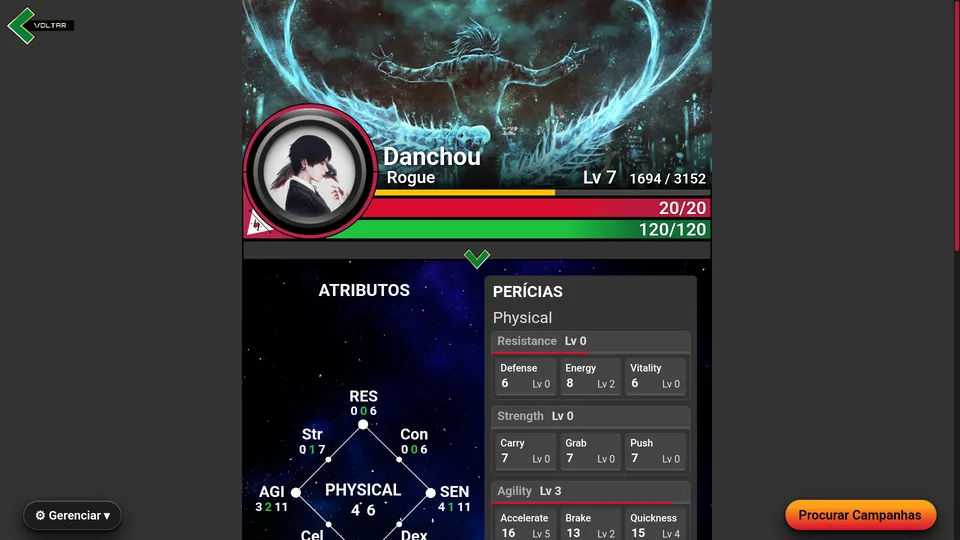
*1920 px: “Gerenciar” no canto esquerdo da janela e “Procurar Campanhas” no direito, sobre o cinza, fora da ficha*

**O que está errado.** Os dois flutuantes da ficha se prendem aos cantos da janela, não da ficha. Em 1366 eles ficam metade dentro, metade fora da coluna; em 1920, a mais de 200 px da ficha, sobre o fundo cinza. Na campanha e na partida, os flutuantes ficam dentro da coluna central.

**Por que importa.** Botão longe do conteúdo a que se refere perde a relação com ele.

**Correção sugerida.** Prender os flutuantes às bordas da coluna da ficha. Fica para o designer junto com o NAV-02 (ficha estreita e sem cabeçalho no desktop), que já está com ele: se a coluna da ficha mudar, a posição dos botões muda junto.

**Onde:** `src/features/sheet/SheetBottomActions.tsx`

#### FICHA-02 · “ATRIBUTOS” longe do diagrama

**Severidade:** Polimento · **Rota:** designer decide · **Esforço:** P
**Tela:** Ver, criar e editar ficha · 768 px para cima

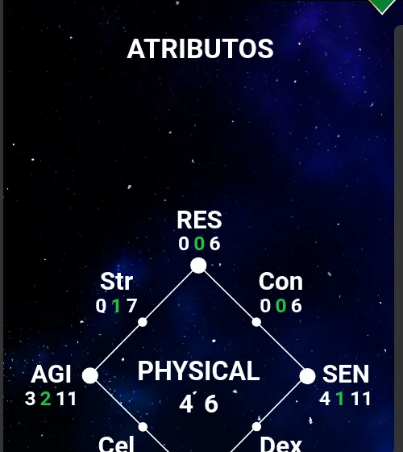
*1920 px: 178 px entre o título “ATRIBUTOS” e o diagrama*

**O que está errado.** A coluna de atributos se estica até a altura da coluna de perícias e distribui o espaço com `justify-content: space-between`: o título fica no topo e os diagramas descem. Medido em 1920: 178 px entre “ATRIBUTOS” e o “RES”.

**Por que importa.** Título separado do conteúdo deixa de parecer título dele (proximidade).

**Correção sugerida.** O título acompanha o primeiro diagrama, e só os diagramas se distribuem na altura (ou tudo encosta no topo). A mudança é na coluna (`AttributesSection`), não nos diagramas da zona pixel-tuned. É do designer porque muda a composição da ficha ao lado das perícias; o `space-around` comentado no código mostra que já houve dúvida aqui.

**Onde:** `src/features/sheet/CharacterSheetTemplate.tsx:367-380`

#### LOB-03 · Lobby: os botões empilhados com larguras diferentes

**Severidade:** Polimento · **Rota:** direto · **Esforço:** P
**Tela:** Lobby do mestre · 768 e 390 px

*390 px: os dois botões empilhados, cada um com sua largura*

**O que está errado.** Quando a coluna estreita, “Iniciar Partida” e “Cancelar Lobby” quebram para duas linhas, alinhados à esquerda e com larguras diferentes (190 e 203 px em 768).

**Por que importa.** Empilhados, dois botões de larguras diferentes parecem desalinhados.

**Correção sugerida.** Empilhados, os dois com a mesma largura (`flex: 1 1 100%` abaixo da largura em que quebram), como a barra de botões dos formulários já faz desde a Task 5 da fase 2.

**Onde:** `src/pages/LobbyPage.tsx:393-398` (`MasterActions`)

## Já decidido (visto de novo, sem achado)

- **Botões flutuantes por cima do conteúdo** (CON-06: manter, com sombra mais forte). No projetor eles cobrem as abas da partida quando a página é curta; dá para rolar. Se incomodar na apresentação, é o mesmo assunto.
- **Números de 9–10 px nos cards das colunas** (A11Y-02: piso só onde cabe, desvio registrado).
- **Termos em inglês** (TXT-01/TXT-02: Nickname, Unaligned, Physical, nomes de classe).
- **Ícones em emoji** (⚙ do Gerenciar; CON-01: briefing para o Claude Design).
- **Ficha estreita e sem cabeçalho no desktop** (NAV-02: com o designer).
- **Dados de teste nas telas** (APR-01).

## Lembretes que continuam de pé

- NAV-02 com o designer e o Claude Design (você pediu para não esquecer).
- Mensagens de erro: avaliar se o padrão da fase 2 basta ou se vale padronizar no Claude Design.
- CON-01: briefing de ícones para o Claude Design.
