# Auditoria de UI/UX antes da apresentação do TCC

Data: 2026-10-25/26 · Branch auditada: `main` em `d11bd58` (já com o PR #81 de tokens mergeado) · Fase 1: só leitura.
Atualizado em 26/10 com a produção, um turno de combate jogado e as decisões já tomadas (marcadas com “Já decidido”).

48 achados de interface (6 críticos, 24 importantes, 18 de polimento) e 7 achados de cor para a sessão de tokens. A identidade visual não está em discussão: os achados são detalhes de consistência, estados, textos, responsividade e acessibilidade.

## Como ler

- **Severidade.** *Crítico*: a banca nota em segundos. *Importante*: aparece num fluxo normal da demonstração. *Polimento*: detalhe que uma banca atenta aponta.
- **Rota.** *direto*: dá para corrigir sem explorar o visual. *Claude Design*: precisa ver 2–3 opções antes de decidir. *designer decide*: questão de gosto ou identidade. *tokens*: vai para a sessão de tokens.
- **Esforço.** P: até meia hora. M: algumas horas. G: um dia ou mais (nenhum achado ficou em G).
- **Onde.** Caminhos relativos a `System_X_System_React/`. A zona pixel-tuned de `src/components/CLAUDE.md` foi respeitada: nenhuma correção propõe normalizar aqueles números.
- Funcionalidades futuras (o sistema de regras, a defesa declarada) não viraram achado para implementar; só a forma como aparecem (CON-02, CON-03).

## Como foi explorado

- `main` rodando localmente na 5173 (back, game e front), com as contas de teste: mestre em `localhost:5173`, jogador em `127.0.0.1:5173`, e uma terceira origem sem sessão para login, cadastro e 404.
- Chrome do usuário (extensão) para a mesa e o editor, que usam a camada Pixi; um Chrome headless com perfil próprio para capturar 160 telas nas larguras 1440, 1280, 1024, 768 e 390 px e medir, por script, fonte, contraste, alvos de toque, rolagem horizontal, imagens quebradas e erros de console.
- Estados forçados interceptando a API no headless: carregando (requisição pendurada), erro (500) e vazio (lista vazia).
- Sessão expirada vista com um token vencido de verdade, que já estava salvo no navegador.
- **Produção (26/10):** o pacote publicado é o mesmo da `main` auditada (comparado arquivo por arquivo; só muda o endereço do servidor do jogo). Telas públicas abertas em 1440 e 390 px; tempo de acordar da API e do jogo medido; CORS das imagens do mapa conferido para o domínio da produção (o fundo do mapa carrega na mesa).
- **Turno de combate (26/10, local):** numa mesa nova da seed, com mestre e dois jogadores abertos ao mesmo tempo: movimento, ataque com aproximação, reação do alvo, “Dar a palavra”, fechar turno, balões de resultado e histórico. Achados: MESA-05 e MESA-06. Fora isso, o fluxo funciona de ponta a ponta nas três visões.
- **Falhas simuladas no local:** login com a API demorando 12 s; lobby e mesa com a conexão do jogo caindo (PROD-01, PROD-02).

**Resultado limpo:** nenhum erro de console nas telas (só os avisos esperados de rota e de recurso inexistentes), nenhuma imagem quebrada e nenhuma rolagem horizontal da página em nenhuma largura. Os estados vazios (“Você ainda não possui campanhas.”, “Nenhuma campanha pública disponível.”, “Ninguém declarou nada ainda.”) estão bem escritos.

**O que ainda não foi verificado:**
- Telas logadas na produção: não entrei com conta na produção, porque não digito senha em site de produção. Como o pacote é idêntico ao da `main`, as telas logadas são as mesmas que foram auditadas no local; o que muda lá é o tempo de espera (PROD-01, PROD-02).
- Tablet físico e gestos no mapa (arrastar e pinça): as larguras de tablet foram simuladas. Vale uma passada de 5 min no tablet, abrindo a produção, **depois** da fase 2 (o RES-01 muda o layout).
- Leitor de tela de verdade: a acessibilidade foi lida no código e no DOM (nomes, rótulos, foco). Para a apresentação, não compensa o tempo agora.
- O socket do jogo com o servidor dormindo de verdade: nas duas medições (12h41 e 13h01), API e jogo estavam acordados, mesmo 18 a 20 min depois do meu último acesso, talvez porque alguém estava usando o site. As telas foram vistas numa simulação local (PROD-01).

## Para o dia da apresentação

Não são correções de código, são cuidados de operação. Valem mesmo depois da fase 2.

1. **Acordar os servidores uns 5 min antes:** abrir o site, entrar e abrir o lobby da partida da demonstração. Depois do PROD-01, o app acorda o servidor do jogo sozinho; abrir cedo continua sendo a garantia.
2. **Não deixar 15 min sem uso no meio:** se a apresentação tiver um bloco longo de slides antes da demonstração, abrir a mesa de novo alguns minutos antes de voltar a ela.
3. **Opcional, só no dia:** um serviço de ping gratuito (cron-job.org, UptimeRobot) chamando o `/health` do jogo e a API a cada 10 min. **Desligar depois:** API e jogo acordados o mês todo dão uns 1.460 h, o dobro das 750 h grátis do workspace, e o Render suspenderia tudo até o mês seguinte.
4. **Zoom do navegador em 150% no projetor** (1920×1080), ou 125% num notebook 1366×768. O painel do mestre usa texto de 11 a 12 px, ilegível do fundo da sala. Em 150%, a mesa cabe inteira e nada fica cortado (testado).
5. **Contas e dados próprios para a apresentação** (APR-01): próxima tarefa.

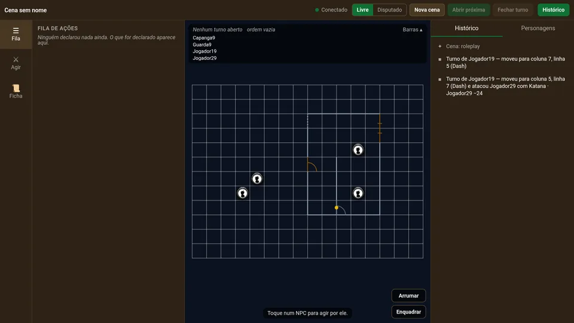  
*Mesa do mestre em 150% de zoom num projetor 1920×1080*

## Resumo

| Id | Achado | Severidade | Rota | Esforço |
|---|---|---|---|---|
| DAT-01 | Datas aparecem um dia antes nos cards | Crítico | direto | P |
| RES-01 | Título da partida quebra no meio da palavra no tablet em pé | Crítico | direto | P |
| TIP-01 | Textos sem fonte própria aparecem em fonte serifada | Crítico | direto | P |
| EST-01 | Carregando e erro trocam a página inteira por um texto solto | Crítico | direto | M |
| PROD-01 | Lobby e mesa desistem antes de o servidor do jogo acordar | Crítico | direto | M |
| APR-01 | Dados de teste aparecem nas telas | Crítico | designer decide | P |
| EST-02 | Não existe página 404 | Importante | direto | P |
| EST-03 | Carregando para sempre em alguns caminhos | Importante | direto | P |
| EST-04 | Sessão expirada sem aviso | Importante | direto | P |
| EST-05 | “Loading...” em inglês e quase invisível nas telas pesadas | Importante | direto | P |
| PROD-02 | A espera pelo servidor acordando não diz por quê | Importante | direto | P |
| FOR-01 | Cadastro concluído sem confirmação | Importante | direto | P |
| FOR-02 | Campos de login e cadastro sem foco visível | Importante | direto | P |
| FOR-03 | Login e cadastro sem rótulos, só placeholder | Importante | direto | P |
| NAV-01 | A mesa não tem saída | Importante | Claude Design | M |
| CON-01 | Ícones misturados: emoji e desenho | Importante | Claude Design | M |
| CON-02 | Regras: placeholder com cara de conteúdo | Importante | direto | P |
| CON-03 | “Decorações” desativada sem explicação | Importante | direto | P |
| CON-04 | Aceitar e recusar inscrição: ✓ e ✗ pequenos e sem nome | Importante | direto | P |
| TXT-01 | “Round” e “rodada” para a mesma coisa | Importante | direto | P |
| TXT-02 | Inglês e português misturados nos termos do jogo | Importante | designer decide | M |
| MESA-01 | Faixa “Barras” mostra só nomes, logo abaixo de “ordem vazia” | Importante | direto | P |
| MESA-02 | Jogador pode montar ação com a sala fechada | Importante | direto | P |
| MESA-03 | HP baixo ilegível nos cards | Importante | direto | P |
| MESA-05 | Botões de reação cortados na borda do mapa | Importante | direto | P |
| EDI-01 | Editor de mapa abre no canto, sem enquadrar | Importante | direto | M |
| A11Y-01 | Foco do teclado com três estilos diferentes | Importante | direto | P |
| A11Y-02 | Textos de 9 a 11 px | Importante | designer decide | M |
| TIP-02 | A fonte Oswald nunca carrega | Importante | designer decide | P |
| FAV-01 | Favicon quebrado | Importante | designer decide | P |
| FAV-02 | Título da aba fixo e com outro nome | Polimento | direto | P |
| FOR-04 | Validação mistura balão do navegador e caixa própria | Polimento | direto | P |
| FOR-05 | Login no celular encosta nas bordas | Polimento | designer decide | P |
| FOR-06 | Campos obrigatórios não marcados | Polimento | direto | P |
| NAV-02 | Ficha sem cabeçalho e estreita no desktop | Polimento | designer decide | M |
| RES-02 | Abas laterais cobrem o texto no celular | Polimento | direto | P |
| CON-05 | “+” em ações que não criam nada | Polimento | direto | P |
| CON-06 | Botões flutuantes por cima de cards e da lista | Polimento | designer decide | P |
| CON-07 | Excluir: motivo truncado e comportamento diferente entre telas | Polimento | direto | P |
| CON-08 | “Expulsar” desativado sem explicação | Polimento | direto | P |
| TXT-03 | Dicas dizem “Toque” também no computador | Polimento | designer decide | P |
| TXT-04 | “Cena sem nome” e “roleplay” em minúsculas | Polimento | direto | P |
| TXT-05 | Reticências e rótulos de carregando diferentes | Polimento | direto | P |
| MESA-04 | Ficha vazia na mesa: uma linha num painel enorme | Polimento | direto | P |
| MESA-06 | Cálculo de acerto num turno que é só movimento | Polimento | direto | P |
| EDI-02 | Editor: nome do mapa sem rótulo | Polimento | direto | P |
| A11Y-03 | Alvos de toque abaixo de 44 px | Polimento | direto | P |
| HALO-01 | Halo dourado na seta Voltar | Polimento | designer decide | P |

### Para a sessão de tokens

| Id | Achado | Severidade | Rota | Esforço |
|---|---|---|---|---|
| COR-01 | Vermelho de erro como borda padrão dos campos | Importante | tokens | P |
| COR-02 | Selo “AGENDADA” com contraste baixo | Importante | tokens | P |
| COR-03 | Confirmar exclusão com o laranja do botão principal | Importante | tokens | P |
| COR-04 | Texto de erro vermelho sobre fundo escuro | Importante | tokens | P |
| COR-05 | Número do HP preto sobre vermelho | Polimento | tokens | P |
| COR-06 | “Lv” cinza na ficha | Polimento | tokens | P |
| COR-07 | Desativados quase invisíveis | Polimento | tokens | P |

## Achados

### Críticos

#### DAT-01 · Datas aparecem um dia antes nos cards

**Severidade:** Crítico · **Rota:** direto · **Esforço:** P  
**Tela:** Lista de campanhas, campanhas públicas, item de partida (data de fim) · mestre e jogador

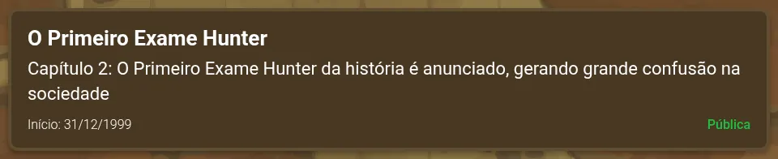  
*Lista: “Início: 31/12/1999”*

  
*Mesma campanha aberta: “Início: 01/01/2000”*

**O que está errado.** O card da lista mostra “Início: 31/12/1999” para a campanha que começa em 01/01/2000; a página da própria campanha mostra a data certa. Todas as datas dos cards saem um dia antes. Os formulários de criar campanha e partida preenchem a data de hoje pelo relógio UTC: depois das 21h no Brasil, já vem o dia seguinte.

**Por que importa.** A banca percebe dado errado na hora, principalmente se o designer criar uma campanha ao vivo e o card mostrar a data de ontem. Consistência entre telas (heurística 4).

**Correção sugerida.** Trocar `new Date(x).toLocaleDateString("pt-BR")` por `formatDateBR(x)`, como o próprio `utils/date.ts` pede. Calcular “hoje / amanhã / em N dias” a partir das partes da data. Data padrão dos formulários pelo dia local, não por `toISOString()`.

**Onde:** `src/components/atoms/CampaignCard.tsx:6-18, 28`; `src/features/campaign/MatchItem.tsx:30`; `src/pages/CreateCampaignPage.tsx:38`; `src/pages/CreateMatchPage.tsx:41-43`

#### RES-01 · Título da partida quebra no meio da palavra no tablet em pé

**Severidade:** Crítico · **Rota:** direto · **Esforço:** P  
**Tela:** Página da partida, lobby e campanha · 768 px e 390 px

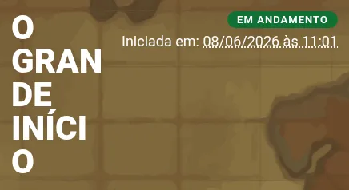  
*768 px: “O / GRAN / DE / INÍCI / O”*

  
*390 px: o título vaza pela direita*

**O que está errado.** Em 768 px o título vira “O / GRAN / DE / INÍCI / O”; na campanha, fica uma palavra por linha. Em 390 px, “REENCONTRAMOS…” passa da borda e fica cortado pela aba REGRAS. Empilhado, o selo de status fica à direita e o resto da coluna à esquerda.

**Por que importa.** Texto partido em sílabas soltas parece defeito no primeiro olhar, e tablet em pé é um formato que o produto suporta.

**Correção sugerida.** Empilhar título e data pela largura da coluna central (container query), não pela largura da janela como hoje (`@media (max-width: 750px)`). Fonte do título com `clamp()`. Evitar `overflow-wrap: break-word` partindo palavras (preferir quebra normal com `hyphens: auto`). Alinhar o bloco de data à esquerda quando empilhado.

**Onde:** `src/features/match/MatchHeaderSection.tsx:80-110`; `src/pages/CampaignPage.tsx:349-372`; `src/pages/LobbyPage.tsx:254, 326-345`

#### TIP-01 · Textos sem fonte própria aparecem em fonte serifada

**Severidade:** Crítico · **Rota:** direto · **Esforço:** P  
**Tela:** Lobby, campanha e partida (selos NPC, Morto, Pendente, AGUARDANDO, ONLINE, Aceito; botões Expulsar, ✓ e ✗), tooltip do Sair, telas de carregando e de erro

> **Já decidido (26/10):** Roboto vira a fonte global, com fallback de fontes do sistema (ver a correção).

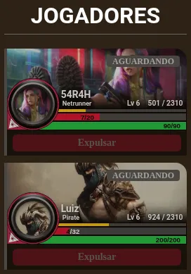  
*Lobby: “AGUARDANDO” e “Expulsar” em serifada*

  
*Tela de erro em serifada*

**O que está errado.** O reset global põe `font-family: 'Lato'` em todo elemento, mas o `index.html` só carrega a Roboto. Sem a Lato, o navegador usa a fonte padrão dele, que é serifada (Times). A mesa já contorna isso em `MatchStageTemplate`; o resto do app não.

**Por que importa.** Uma serifada no meio de uma interface toda em Roboto parece erro. Aparece em telas comuns (os selos dos cards), não só em casos raros.

**Correção sugerida.** Tirar o `font-family` do seletor `*` e pôr a fonte uma vez só no `body`, com `font: inherit` em botões e campos (eles não herdam a fonte por padrão). Assim tudo herda a Roboto, em vez de cada elemento receber a fonte à força, que é o que hoje impede a herança. O token `fonts.sans` ganha uma pilha de fallback do sistema (`system-ui`, Segoe UI, Arial e o genérico `sans-serif` no fim), que não precisa ser baixada e nunca cai em serifada. Na mesma mudança: saem as dezenas de repetições de `"Roboto", sans-serif` espalhadas e o contorno do `MatchStageTemplate.tsx:106-115`, e corrige-se o `"sans-serif"` entre aspas de `BaseButton` e `SignPagesTemplate` (entre aspas ele vira o nome de uma fonte, não o fallback genérico). Conferir a zona pixel-tuned da ficha antes e depois: algum texto ali pode estar hoje na serifada.

**Onde:** `src/styles/ResetStyle.ts:73-75`; `src/styles/tokens.ts:194-197`; `src/components/ions/BaseButton.tsx:17`; `src/components/templates/SignPagesTemplate.tsx:45`; `src/components/molecules/CharacterSidebarItem.tsx:128-160`; `src/features/match/LobbyConnectionSidebarItem.tsx:129`; `src/features/match/EnrollmentSidebarItem.tsx:129`; `src/components/atoms/PageStates.tsx:4-22`

#### EST-01 · Carregando e erro trocam a página inteira por um texto solto

**Severidade:** Crítico · **Rota:** direto · **Esforço:** M  
**Tela:** Listas e páginas de detalhe: campanhas, públicas, fichas, campanha, partida, ficha · mestre e jogador

> **Já decidido (26/10):** Prioridade da fase 2: é a tela que a banca tende a ver enquanto a produção acorda.

  
*Carregando: só o texto, sem cabeçalho*

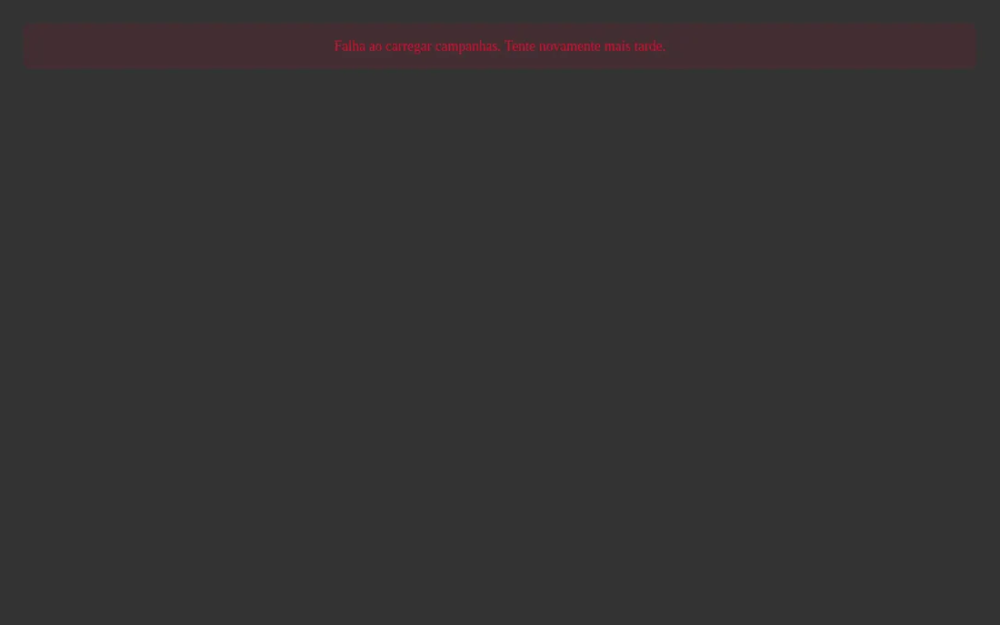  
*Erro: faixa pequena no topo, sem saída*

**O que está errado.** Enquanto carrega, a página some e fica só “Carregando campanhas...” em serifada, num fundo cinza. Com erro, aparece uma faixa vermelha pequena no topo, sem cabeçalho, sem voltar e sem “Tentar de novo”. Campanha inexistente diz “Falha ao carregar detalhes da campanha.”, enquanto ficha inexistente diz “Ficha não encontrada.”.

**Por que importa.** Na hospedagem gratuita, a primeira requisição pode levar dezenas de segundos (o servidor dorme). É provável que a banca veja exatamente esta tela. Heurísticas 1 (estado do sistema), 3 (saída) e 9 (recuperar de erros).

**Correção sugerida.** Um estado de página que mantém o `PageHeader` (logo e voltar) e centraliza a mensagem em Roboto, com “Tentar de novo” (`refetch`) no erro. Para 404: “Campanha não encontrada” com link para a lista. Opcional: esqueleto no lugar do texto.

**Onde:** `src/components/atoms/PageStates.tsx:4-22`; `src/components/templates/ListPageTemplate.tsx:28-33`; `src/pages/CampaignPage.tsx:140-148`; `src/pages/MatchPage.tsx:239-241`; `src/pages/CharacterSheetPage.tsx`

#### PROD-01 · Lobby e mesa desistem antes de o servidor do jogo acordar

**Severidade:** Crítico · **Rota:** direto · **Esforço:** M  
**Tela:** Lobby e mesa, mestre e jogador · produção (Render gratuito)

> **Já decidido (26/10):** Faz parte dos estados de espera que você já aprovou (EST-01): é como eles aparecem na produção.

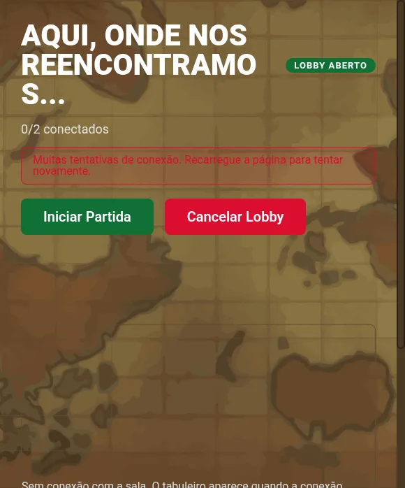  
*Lobby sem conexão: desiste em 9 s e manda recarregar*

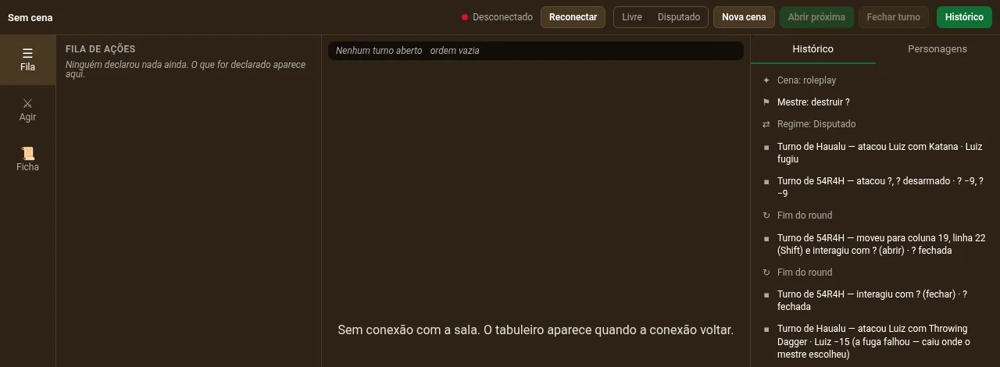  
*Mesa sem conexão: “Desconectado” em 32 s e “?” no lugar dos nomes no histórico*

**O que está errado.** Na produção, o servidor do jogo dorme depois de 15 min sem ninguém na mesa, separado da API: dá para navegar pelas campanhas com a API acordada e encontrar o jogo dormindo ao abrir o lobby. Em 26/10 ele levou cerca de 3 min para acordar (2 min sem resposta e mais 55 s); em 22/10 tinham sido 12 s. O lobby desiste depois de 5 tentativas, em cerca de 9 s, com “Muitas tentativas de conexão. Recarregue a página para tentar novamente.”, como se a culpa fosse de quem abriu. A mesa desiste em cerca de 32 s e fica em “Desconectado”. Sem conexão, “Iniciar Partida” continua ativo e não faz nada (a mensagem só sai com o socket aberto), e o histórico da mesa mostra “?” no lugar dos nomes de NPCs e portas. Os 9 s e 32 s vêm de uma simulação no local, com a conexão falhando na hora. Não deu para ver o socket com o servidor dormindo de verdade, porque nas duas tentativas (12h41 e 13h01) ele estava acordado. Se o Render segurar a conexão enquanto acorda, em vez de recusar, a tela fica parada em “Conectando…”, também sem explicação. A correção cobre os dois casos.

**Por que importa.** É o cenário mais provável da apresentação: o designer mostra as campanhas e depois abre a mesa. A banca veria uma mensagem de erro mandando recarregar, na parte principal do produto. Heurísticas 1 (estado do sistema) e 9 (recuperar de erros).

**Correção sugerida.** (1) Acordar cedo: assim que existe sessão (login feito ou app aberto já logado), um `GET /health` do game em segundo plano, sem esperar a resposta. Quando o designer chegar ao lobby, o servidor já acordou. A URL HTTP sai do `VITE_WS_URL` (troca `wss` por `https`). (2) Paciência medida em tempo, não em tentativas: seguir tentando por até uns 3 min, com intervalo máximo de poucos segundos, e mostrar “Acordando o servidor da mesa… pode levar até um minuto.” desde a primeira falha. Só no fim, “Tentar de novo”. Hoje lobby e mesa têm duas políticas diferentes, uma em cada hook (5 tentativas a partir de 0,5 s e 5 a partir de 1 s): vale extrair uma política única que os dois usem. (3) Desativar “Iniciar Partida” e “Cancelar Lobby” enquanto não há conexão.

**Onde:** `src/hooks/useLobbyWs.ts:67-69, 270-292, 318-325`; `src/hooks/useMatchWs.ts:71-72, 406-430`; `src/pages/LobbyPage.tsx:191-205, 268-276`; `src/features/match/combat/MatchTopBar.tsx:9-15`; `src/features/match/combat/useGameTable.ts:236-246`

#### APR-01 · Dados de teste aparecem nas telas

**Severidade:** Crítico · **Rota:** designer decide · **Esforço:** P  
**Tela:** Lista de campanhas, campanha, partidas, cards

> **Já decidido (26/10):** Fica para a próxima tarefa: contas com dados feitos só para a apresentação.

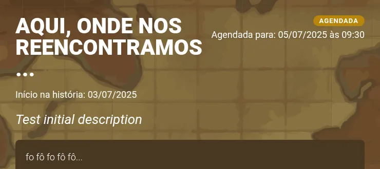  
*Descrição “fo fô fo fô fô...”*

  
*Campanha “asdfasdf”*

**O que está errado.** A conta usada nos testes tem a campanha “asdfasdf”, descrições “Test initial description” e “fo fô fo fô fô...”, partidas “test match” e “Smoke Fase6 match B” e personagens “SmkP2”, “SmkP3” e “SmkNPC”.

**Por que importa.** Se a apresentação usar este banco, ou um com o mesmo tipo de dado, é a primeira coisa que a banca lê.

**Correção sugerida.** Preparar uma conta de apresentação com uma ou duas campanhas completas e textos reais (dá para estender a `cmd/devseed` com um modo “demo”) e ensaiar o roteiro nela.

**Onde:** Sem código: dados; `System_X_System/cmd/devseed`

### Importantes

#### EST-02 · Não existe página 404

**Severidade:** Importante · **Rota:** direto · **Esforço:** P  
**Tela:** Qualquer endereço desconhecido

  
*“/rota-que-nao-existe”: tela cinza vazia*

**O que está errado.** Um endereço errado mostra uma tela cinza vazia: sem logo, sem mensagem, sem caminho de volta.

**Por que importa.** Parece que o app quebrou (heurística 9).

**Correção sugerida.** Rota `path="*"` com uma página simples (logo, “Página não encontrada”, botão “Ir para o início”), reaproveitando o fundo e o cabeçalho das telas de lista.

**Onde:** `src/App.tsx:30-112 (não há rota `*`)`

#### EST-03 · Carregando para sempre em alguns caminhos

**Severidade:** Importante · **Rota:** direto · **Esforço:** P  
**Tela:** Mesa, editor de mapa e rotas abertas sem sessão

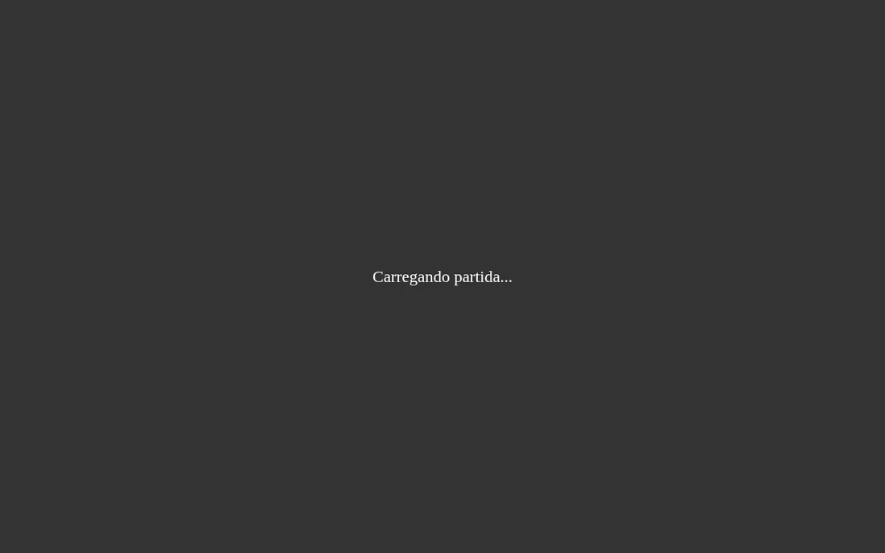  
*Mesa com a API falhando: “Carregando partida...” para sempre*

**O que está errado.** Se a API da partida falha, a mesa fica em “Carregando partida...” para sempre, e o editor de mapa em “Carregando mapa...”. Sem login, `/campaigns` e a página da campanha ficam carregando para sempre e `/campaigns/new` abre o formulário; as outras páginas mandam para o login.

**Por que importa.** Estado sem saída: a pessoa não sabe se espera ou recarrega.

**Correção sugerida.** Tratar `isError` antes do loading guard em `GamePage` e `EditMapPage`. Adicionar o `if (!token) return <Navigate to="/" replace />` que falta em `CampaignsPage`, `CampaignPage`, `CreateCampaignPage` e `CreateMapPage`.

**Onde:** `src/pages/GamePage.tsx:39-41`; `src/pages/EditMapPage.tsx:34-41`; `src/pages/CampaignsPage.tsx`; `src/pages/CampaignPage.tsx`; `src/pages/CreateCampaignPage.tsx`; `src/pages/CreateMapPage.tsx`

#### EST-04 · Sessão expirada sem aviso

**Severidade:** Importante · **Rota:** direto · **Esforço:** P  
**Tela:** Qualquer página logada depois de 24 h

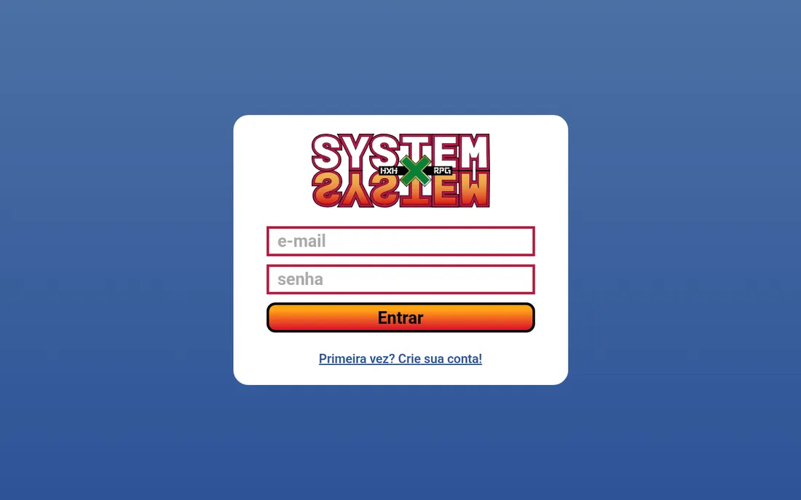  
*Para onde a pessoa vai: o login, sem mensagem*

**O que está errado.** Com o token vencido, a Home aparece normalmente, porque não faz requisição. No primeiro clique que chama a API, o app limpa a sessão e leva ao login sem dizer por quê.

**Por que importa.** Parece que o app saiu da conta sozinho (heurística 1).

**Correção sugerida.** No interceptor de 401, gravar um aviso (ex.: `sessionStorage["sessionExpired"]`) antes do redirecionamento; o login mostra “Sua sessão expirou. Entre de novo.” e apaga o aviso. Opcional: voltar para a página onde a pessoa estava.

**Onde:** `src/services/httpClient.ts:19-23`; `src/pages/LoginPage.tsx`

#### EST-05 · “Loading...” em inglês e quase invisível nas telas pesadas

**Severidade:** Importante · **Rota:** direto · **Esforço:** P  
**Tela:** Lobby, mesa, criar e editar mapa (primeira abertura)

  
*Canto superior esquerdo, ampliado 3×*

**O que está errado.** Enquanto o código da tela baixa, aparece “Loading...” em inglês, preto sobre cinza escuro, no canto superior esquerdo, em serifada.

**Por que importa.** Fica quase invisível e destoa do resto. Aparece toda vez que a hospedagem demora.

**Correção sugerida.** Usar o mesmo componente de carregando das outras páginas, com “Carregando…”.

**Onde:** `src/App.tsx:69, 77, 85, 93`

#### PROD-02 · A espera pelo servidor acordando não diz por quê

**Severidade:** Importante · **Rota:** direto · **Esforço:** P  
**Tela:** Login e a primeira página depois de 15 min parado · produção

> **Já decidido (26/10):** Mesmo motivo do PROD-01: a espera da API acordando, no login e nas páginas.

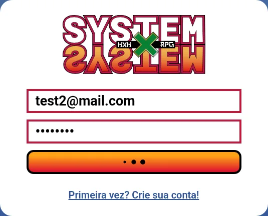  
*Login com a API acordando: só os três pontinhos*

**O que está errado.** A API também dorme. Em 26/10 ela levou 14 s para acordar (a documentação do Render fala em até um minuto). No login, o botão “Entrar” mostra três pontinhos durante todo esse tempo, sem explicação. Depois de um intervalo (os slides, por exemplo), a primeira página aberta fica o mesmo tempo em “Carregando campanhas...”.

**Por que importa.** Catorze segundos de pontinhos parecem travamento. Na frente da banca, a tendência é clicar de novo ou recarregar.

**Correção sugerida.** Depois de uns 3 s de espera, uma segunda linha: “O servidor está acordando. Isso pode levar até um minuto.” Ela entra no login e no estado de carregando de página do EST-01, um componente só. O “acordar cedo” do PROD-01 vale para a API também: uma requisição leve ao abrir a tela de login acorda a API enquanto a pessoa digita. A API ainda não tem `/health` (o game tem); criar um no back é o caminho limpo, com contrato.

**Onde:** `src/pages/LoginPage.tsx:24, 73`; `src/components/atoms/PageStates.tsx`; `System_X_System: rota `/health` da API (não existe)`

#### FOR-01 · Cadastro concluído sem confirmação

**Severidade:** Importante · **Rota:** direto · **Esforço:** P  
**Tela:** Cadastro → login

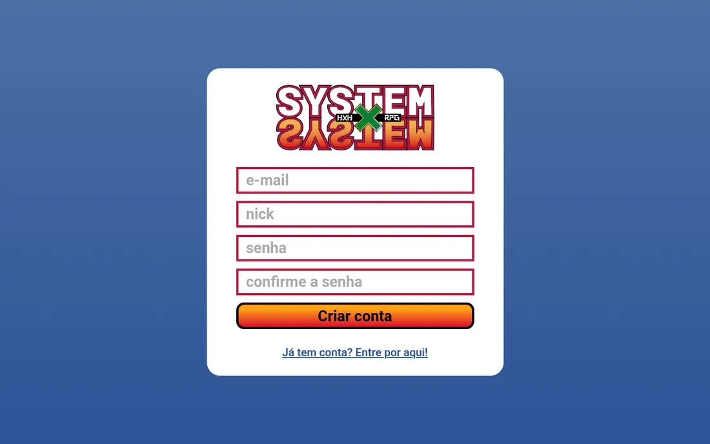  
*Depois de “Criar conta”, volta para esta tela vazia*

**O que está errado.** Depois de “Criar conta”, o app volta para o login vazio, sem mensagem. A pessoa não sabe se a conta foi criada.

**Por que importa.** Heurística 1. O designer provavelmente vai criar uma conta ao vivo.

**Correção sugerida.** Navegar com estado (`navigate("/", { state: { registered: email } })`) e mostrar no login “Conta criada. Entre com seu e-mail e senha.”, com o e-mail já preenchido.

**Onde:** `src/pages/RegisterPage.tsx:38-41`; `src/pages/LoginPage.tsx`

#### FOR-02 · Campos de login e cadastro sem foco visível

**Severidade:** Importante · **Rota:** direto · **Esforço:** P  
**Tela:** Login e cadastro

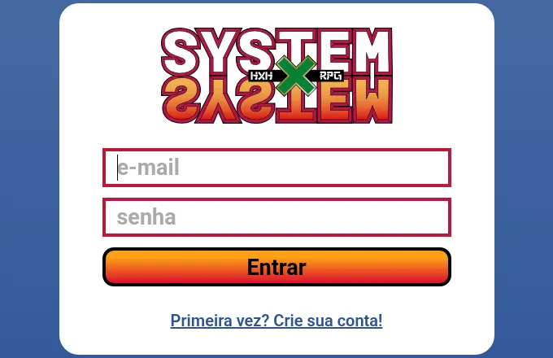  
*E-mail focado pelo teclado: igual aos outros campos*

**O que está errado.** O campo focado fica igual aos outros: o CSS tira o contorno no foco e não põe nada no lugar. Quem usa o teclado não sabe onde está.

**Por que importa.** WCAG 2.4.7 (foco visível).

**Correção sugerida.** `&:focus-visible` com o anel de foco do produto (ver A11Y-01).

**Onde:** `src/components/ions/BaseInput.tsx:160-162`

#### FOR-03 · Login e cadastro sem rótulos, só placeholder

**Severidade:** Importante · **Rota:** direto · **Esforço:** P  
**Tela:** Login e cadastro

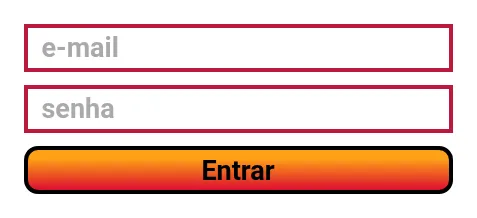  
*Só “e-mail” e “senha” dentro do campo*

**O que está errado.** Os campos só têm o placeholder (“e-mail”, “senha”), que some ao digitar. Não há `<label>`, `aria-label` nem `autocomplete`, então o gerenciador de senhas não distingue senha atual de senha nova.

**Por que importa.** WCAG 1.3.1 e 3.3.2: o leitor de tela anuncia um campo sem nome.

**Correção sugerida.** `aria-label` (ou rótulo visualmente oculto) em cada campo; `autocomplete="email"`, `"current-password"`, `"new-password"` e `"username"` no nick. O `BaseInput` precisa repassar essas props.

**Onde:** `src/pages/LoginPage.tsx:53-71`; `src/pages/RegisterPage.tsx:51-89`; `src/components/ions/BaseInput.tsx:4-17`

#### NAV-01 · A mesa não tem saída

**Severidade:** Importante · **Rota:** Claude Design · **Esforço:** M  
**Tela:** Mesa · mestre e jogador

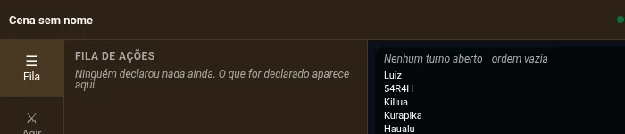  
*Barra da mesa: nenhuma seta, logo ou “Sair”*

**O que está errado.** Na mesa não há seta de voltar, logo ou “Sair”: só o botão do navegador tira a pessoa dali. No tablet em tela cheia, não há saída nenhuma.

**Por que importa.** Heurística 3 (controle e liberdade). A banca vai perguntar como volta.

**Correção sugerida.** Um “Sair da mesa” (ou a seta de voltar) à esquerda do nome da cena, levando à página da partida, com confirmação se houver turno aberto. Precisa caber na barra do mestre, que já tem seis controles: por isso vale ver opções.

**Onde:** `src/features/match/combat/MatchTopBar.tsx:44-80`; `src/components/templates/MatchStageTemplate.tsx`

#### CON-01 · Ícones misturados: emoji e desenho

**Severidade:** Importante · **Rota:** Claude Design · **Esforço:** M  
**Tela:** Mesa (☰ Fila, ⚔ Agir, 📜 Ficha), menu Gerenciar (⚙ e 🗑 ao lado do lápis em SVG), barras (⚔ ➜), inscrições (✓ ✗), editor (↺ ↻)

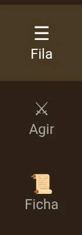  
*Trilho da mesa: ☰ e ⚔ monocromáticos, 📜 colorido*

  
*Menu: lápis em SVG, lixeira em emoji*

**O que está errado.** Parte dos ícones é SVG do projeto e parte é emoji ou caractere. Emoji muda com o sistema: o 📜 sai colorido no Windows e no Android, enquanto ☰ e ⚔ saem monocromáticos; ao lado do lápis em SVG, o 🗑 destoa.

**Por que importa.** Consistência visual (heurística 4). No computador da banca, os ícones podem sair diferentes dos que o designer vê.

**Correção sugerida.** Um conjunto de ícones SVG no mesmo traço dos que já existem em `src/assets/icons`, cobrindo fila, agir, ficha, engrenagem, lixeira, aceitar, recusar, desfazer, refazer e as duas barras.

**Onde:** `src/pages/GameMasterPage.tsx:611-613`; `src/pages/GamePlayerPage.tsx:257-258`; `src/components/molecules/ManageButton.tsx:58, 61, 72`; `src/features/match/combat/combatText.ts:11`; `src/features/match/EnrollmentSidebarItem.tsx:74, 84`; `src/features/tactical-map/MapEditorToolbar.tsx:175-190`

#### CON-02 · Regras: placeholder com cara de conteúdo

**Severidade:** Importante · **Rota:** direto · **Esforço:** P  
**Tela:** Coluna REGRAS da campanha, da partida e do lobby

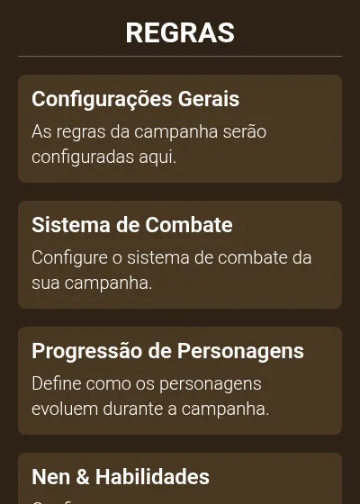  
*Cards de regra sem nenhum “em breve”*

**O que está errado.** Os cards (“Configurações Gerais”, “Sistema de Combate”…) parecem seções com conteúdo. Só a tela de criar campanha avisa “Mais opções de configuração serão adicionadas em breve.”. No lobby há dois cards; nas outras telas, quatro.

**Por que importa.** Placeholder com cara de bug é diferente de um “em breve” claro. A banca pode clicar e nada acontece.

**Correção sugerida.** Selo “Em breve” no título da coluna, a mesma nota de rodapé em todas as telas, os mesmos cards em todo lugar e cursor padrão (sem parecer clicável).

**Onde:** `src/components/organisms/RulesSidebar.tsx`; `src/pages/CampaignPage.tsx:186-198`; `src/pages/MatchPage.tsx`; `src/pages/LobbyPage.tsx`

#### CON-03 · “Decorações” desativada sem explicação

**Severidade:** Importante · **Rota:** direto · **Esforço:** P  
**Tela:** Editor de mapa

  
*A quinta aba, apagada e sem dica*

**O que está errado.** A aba aparece apagada e não responde, sem dizer por quê. O rótulo mal cabe no botão.

**Por que importa.** Mesmo caso das regras: parece quebrado.

**Correção sugerida.** Tooltip “Em breve” e um selo pequeno, ou esconder a aba até a função existir.

**Onde:** `src/features/tactical-map/MapEditorToolbar.tsx:59, 155-162`

#### CON-04 · Aceitar e recusar inscrição: ✓ e ✗ pequenos e sem nome

**Severidade:** Importante · **Rota:** direto · **Esforço:** P  
**Tela:** Página da partida, lista de inscrições · mestre

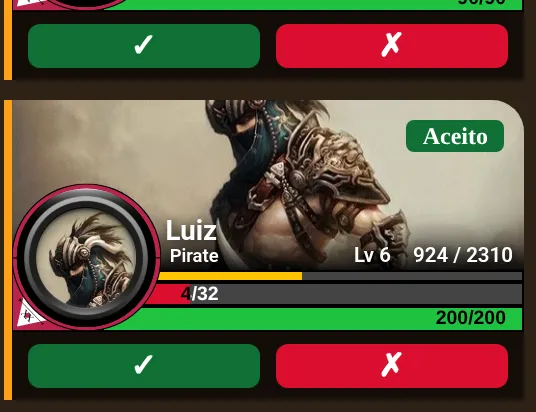  
*Inscrição já “Aceito” ainda com ✓ e ✗*

**O que está errado.** Os botões têm 21 px de altura e só o caractere ✓ ou ✗ (o leitor de tela lê “marca de verificação”). Continuam aparecendo depois que a inscrição foi aceita.

**Por que importa.** Alvo abaixo de 44 px num fluxo que o mestre faz no tablet, e dúvida sobre o estado da inscrição.

**Correção sugerida.** Botões com 44 px, `aria-label="Aceitar inscrição de {nick}"` e “Recusar…”, e mostrar só a ação que ainda faz sentido.

**Onde:** `src/features/match/EnrollmentSidebarItem.tsx:64-86, 129-147`

#### TXT-01 · “Round” e “rodada” para a mesma coisa

**Severidade:** Importante · **Rota:** direto · **Esforço:** P  
**Tela:** Mesa: barra do mestre, histórico e diálogo de nova cena

  
*Botão “Encerrar rodada”*

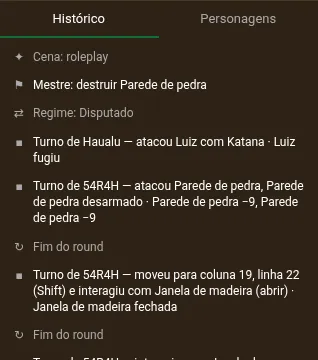  
*Histórico: “Fim do round”*

**O que está errado.** O botão diz “Encerrar rodada”, o histórico diz “Fim do round” e o diálogo de cena diz “Fecha a cena e o round atuais”.

**Por que importa.** Um termo do jogo com dois nomes. O glossário do projeto define Round = Rodada.

**Correção sugerida.** “Fim da rodada” e “Fecha a cena e a rodada atuais”.

**Onde:** `src/features/match/combat/EventStream.tsx:81, 147`; `src/features/match/combat/SceneChangeDialog.tsx:41`

#### TXT-02 · Inglês e português misturados nos termos do jogo

**Severidade:** Importante · **Rota:** designer decide · **Esforço:** M  
**Tela:** Ficha, criar ficha e NPC, cards, mesa

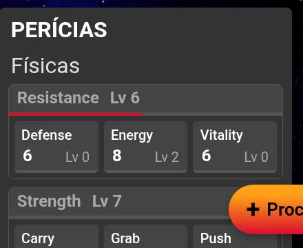  
*Ficha: “PERÍCIAS / Físicas” sobre “Resistance, Defense, Energy”*

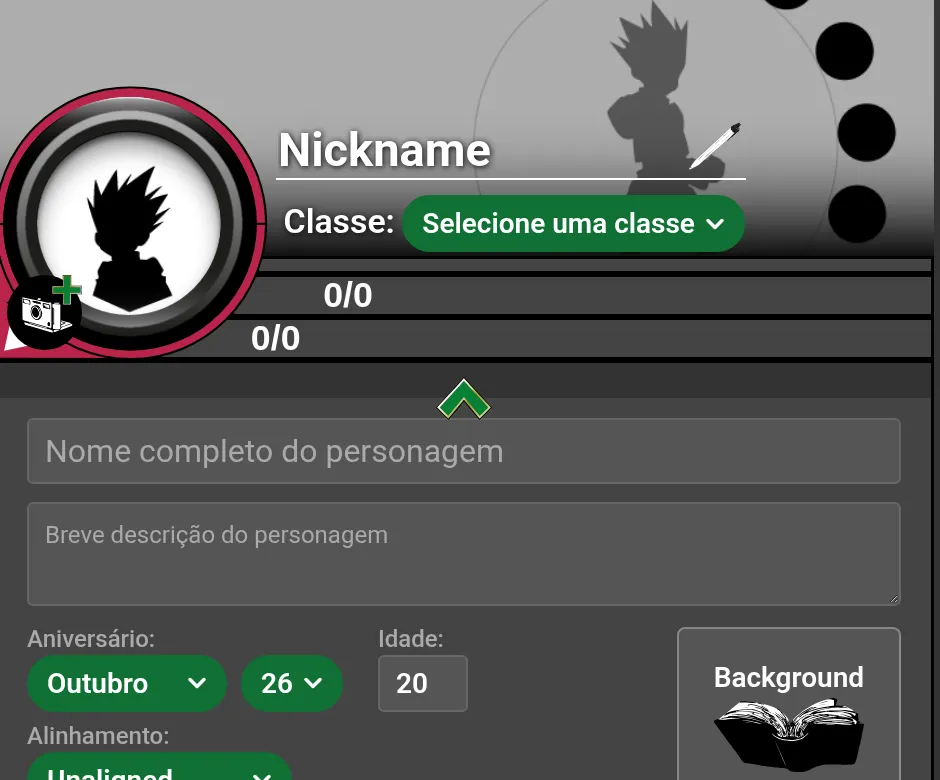  
*Criar ficha: “Nickname”, “Unaligned”, “Background”*

**O que está errado.** Classes (“Netrunner”, “Pirate”, “WeaponsMaster” sem espaço), atributos e perícias (“PHYSICAL”, “Resistance”, “Strength”, “Str”, “AGI”), alinhamento (“Unaligned”, “Chaotic Neutral”), “Nickname”, “Background”, “Lv”, movimentos (“Dash”, “Shift”) e “roleplay” convivem com “ATRIBUTOS”, “PERÍCIAS” e “Físicas”.

**Por que importa.** Pode ser identidade (termos do sistema), mas hoje a regra não aparece: títulos em português sobre itens em inglês.

**Correção sugerida.** Escolher a regra (tudo em português, ou termos do sistema em inglês e interface em português) e aplicar. No mínimo, “Weapons Master” com espaço e “Nickname” e “Background” em português.

**Onde:** Rótulos espalhados; as classes vêm do back (`/classes`); `src/features/match/combat/ActionComposer.tsx:14-15`; `src/features/sheet/`

#### MESA-01 · Faixa “Barras” mostra só nomes, logo abaixo de “ordem vazia”

**Severidade:** Importante · **Rota:** direto · **Esforço:** P  
**Tela:** Mesa, antes de alguém agir · mestre e jogador

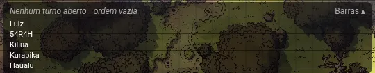  
*“ordem vazia” seguido de cinco nomes*

**O que está errado.** Com a faixa aberta e ninguém tendo agido, ela lista só os nomes (Luiz, 54R4H, Killua…), sem barra nenhuma, logo abaixo de “ordem vazia”. Parece a ordem de turno e contradiz o texto.

**Por que importa.** A informação se contradiz no ponto mais visível da mesa.

**Correção sugerida.** Esconder as linhas sem dado (ou mostrar “ninguém agiu ainda”) e trocar “ordem vazia” por algo como “Ninguém na ordem de turno”.

**Onde:** `src/features/match/combat/CharacterBarsStrip.tsx:24-43`; `src/features/match/combat/GeneralBar.tsx:49-55`

#### MESA-02 · Jogador pode montar ação com a sala fechada

**Severidade:** Importante · **Rota:** direto · **Esforço:** P  
**Tela:** Mesa do jogador, aguardando o mestre

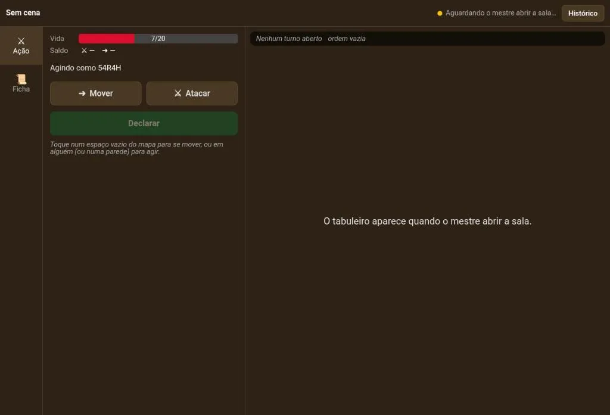  
*“Aguardando o mestre…” com Mover e Atacar ativos*

**O que está errado.** Com “Aguardando o mestre abrir a sala…” e sem tabuleiro, “Mover” e “Atacar” continuam ativos e a dica pede para tocar no mapa, que não existe.

**Por que importa.** Heurística 5 (prevenir erro).

**Correção sugerida.** Desativar o compositor, ou trocar por um aviso, enquanto a conexão não está pronta ou não há tabuleiro.

**Onde:** `src/features/match/combat/ActionComposer.tsx (Mover e Atacar sem `disabled`; `:247` só no Declarar)`; `src/pages/GamePlayerPage.tsx:279`

#### MESA-03 · HP baixo ilegível nos cards

**Severidade:** Importante · **Rota:** direto · **Esforço:** P  
**Tela:** Cards de personagem: campanha, partida, lobby, mesa

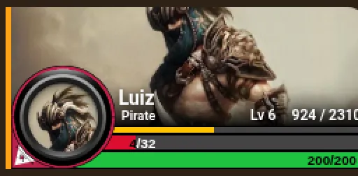  
*Tamanho real ampliado 2×: “/32”*

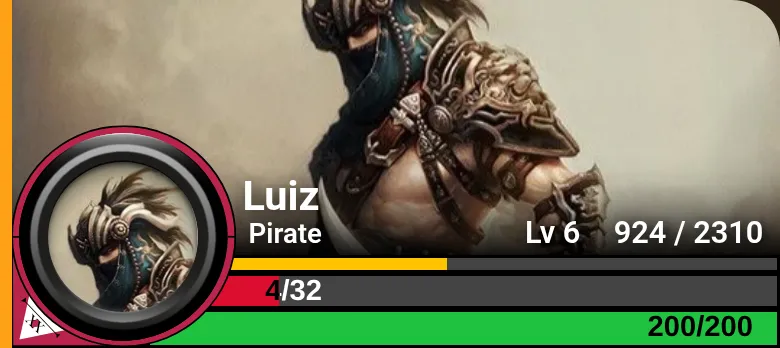  
*Em 3×: “4/32”, o 4 preto sobre o vermelho*

**O que está errado.** Com pouca vida, o número fica metade preto sobre o vermelho e metade branco sobre o cinza, em uns 10 px: “4/32” é lido como “/32”.

**Por que importa.** O número some justamente quando a vida importa.

**Correção sugerida.** Quando o preenchimento for mais estreito que o rótulo, desenhar o rótulo inteiro na cor da trilha, à direita do preenchimento. A mudança fica no `ProgressBar`, fora da zona pixel-tuned; os números do `CharacterSheetHeader` não mudam.

**Onde:** `src/components/ions/ProgressBar.tsx:105-128`

#### MESA-05 · Botões de reação cortados na borda do mapa

**Severidade:** Importante · **Rota:** direto · **Esforço:** P  
**Tela:** Mesa · jogador atacado, com a peça perto da borda da área do mapa

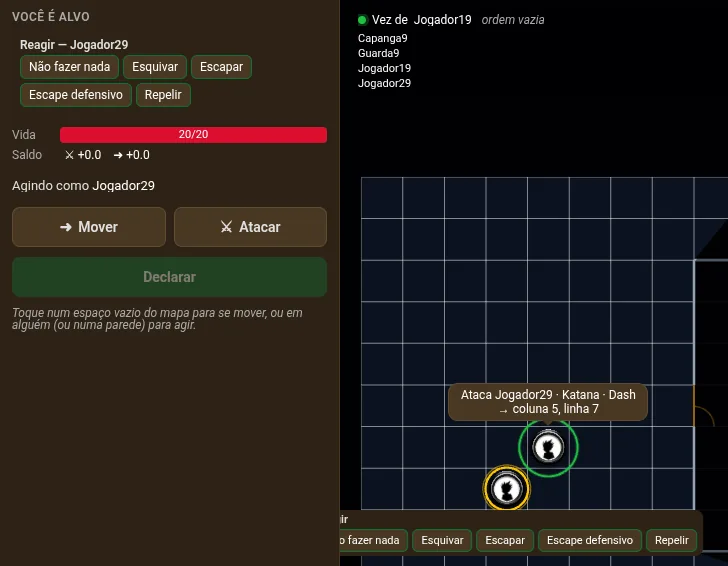  
*No mapa, “ir” e “o fazer nada”; no painel, os mesmos botões inteiros*

**O que está errado.** Os botões de reação que aparecem embaixo da peça atacada são centralizados nela, e nada os empurra de volta para dentro. Com a peça perto da borda, a camada corta o que sobra: aparece “ir” no lugar de “Reagir” e “o fazer nada” no lugar de “Não fazer nada”. Os balões de cima da peça estão na mesma camada e têm o mesmo risco.

**Por que importa.** É o momento mais de jogo da demonstração (alguém atacado escolhendo como reagir), e o corte parece defeito.

**Correção sugerida.** Limitar a posição horizontal de cada item à largura da camada: o `MapPieceOverlay` já mede as caixas para empilhar na vertical, então basta deslocar para dentro quem passa da borda. A ponta do balão continua apontando para a peça. A conta fica numa função de layout com teste (a camada é HTML, não Pixi).

**Onde:** `src/features/match/combat/MapPieceOverlay.tsx:48-63, 98-112`; `src/features/match/combat/overlayLayout.ts`

#### EDI-01 · Editor de mapa abre no canto, sem enquadrar

**Severidade:** Importante · **Rota:** direto · **Esforço:** M  
**Tela:** Criar e editar mapa

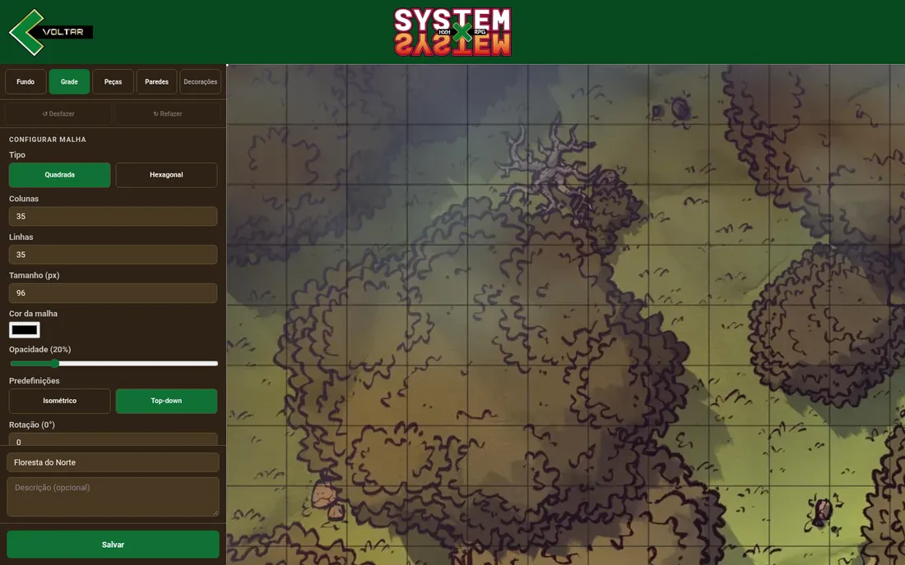  
*Mapa de 35×35 casas aberto em 1:1 no canto*

**O que está errado.** O mapa abre em 1:1 no canto superior esquerdo: num mapa de 35×35 casas aparece só um pedaço de mato. O editor não tem “Enquadrar” (a mesa tem).

**Por que importa.** Na banca, a pergunta vai ser “cadê o mapa?”. A mesa já resolve isso com o mesmo componente.

**Correção sugerida.** Passar `fitRequest` no editor (enquadrar ao abrir) e pôr o botão “Enquadrar” no canto, como na mesa.

**Onde:** `src/features/tactical-map/stage/ViewportInner.tsx:186-207 (enquadramento só na mesa)`; `src/features/tactical-map/TacticalMapEditor.tsx`

#### A11Y-01 · Foco do teclado com três estilos diferentes

**Severidade:** Importante · **Rota:** direto · **Esforço:** P  
**Tela:** Todas as telas

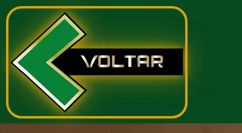  
*Header: anel dourado*

  
*Login: nenhum indicador*

**O que está errado.** A seta e a logo do header usam anel dourado; os campos dos formulários, borda verde; o resto (botões da mesa, cards, abas) fica com o contorno padrão do navegador; os campos de login não têm nenhum (FOR-02).

**Por que importa.** WCAG 2.4.7 e consistência. O contorno padrão some sobre os fundos marrons.

**Correção sugerida.** Uma regra global de `:focus-visible` no reset, com o anel do produto (`actionHighlight`, 2 px, afastado 3 a 5 px). Componentes só sobrescrevem quando precisam.

**Onde:** `src/styles/ResetStyle.ts`; `src/components/ions/BackButton.tsx:53-56`; `src/components/atoms/LogoButton.tsx`

#### A11Y-02 · Textos de 9 a 11 px

**Severidade:** Importante · **Rota:** designer decide · **Esforço:** M  
**Tela:** Cards de personagem, editor de mapa, faixa de barras da mesa

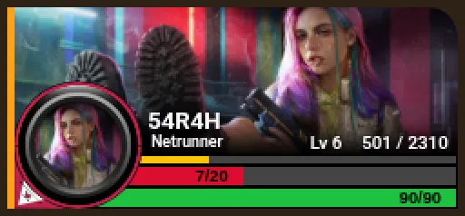  
*Card ampliado 2×: classe, Lv e EXP em 9–10 px*

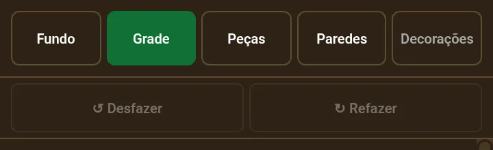  
*Editor: abas em 10–11 px*

**O que está errado.** Nos cards, classe, nível, EXP e HP ficam entre 9 e 10 px; no editor, abas e rótulos entre 10 e 11 px; na mesa, a faixa de barras tem 11 px.

**Por que importa.** Num projetor, ou num tablet a um metro, não se lê. Não é critério AA (não há tamanho mínimo), mas é o que a banca vai ver.

**Correção sugerida.** Os cards estão na zona pixel-tuned (`CharacterSheetHeader`): mudar o tamanho é decisão do designer junto com os SVGs. No editor e na mesa, subir para 12–13 px é direto.

**Onde:** `src/components/molecules/CharacterSheetHeader.tsx (zona pixel-tuned)`; `src/features/tactical-map/MapEditorToolbar.tsx`; `src/features/match/combat/CharacterBarsStrip.tsx:78`

#### TIP-02 · A fonte Oswald nunca carrega

**Severidade:** Importante · **Rota:** designer decide · **Esforço:** P  
**Tela:** Home (PERSONAGENS, CAMPANHAS), botão SAIR, números das barras de HP, SP e EXP, títulos dos grupos de atributo

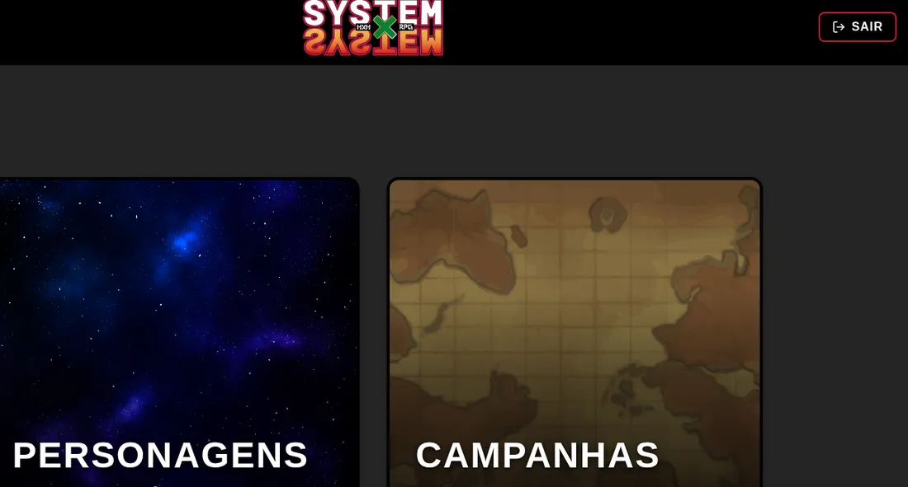  
*Home: títulos e SAIR na fonte do sistema*

**O que está errado.** O token `fonts.display` aponta para a Oswald, que o `index.html` não carrega. Hoje esses textos saem na sans-serif do sistema: DejaVu ou Liberation no Linux, Arial no Windows, Helvetica no Mac. O visual que o professor aprovou já é o da fonte substituta, e ele muda de computador para computador.

**Por que importa.** A identidade não é a mesma na máquina do designer e na da banca.

**Correção sugerida.** Escolher: (a) carregar a Oswald, o que muda os títulos para o desenho original; ou (b) apontar o token para uma fonte carregada que fique próxima do visual atual. Nos dois casos, a fonte precisa ser carregada.

**Onde:** `index.html:6-10`; `src/styles/tokens.ts:194-197`; `src/components/atoms/NavigationCard.tsx:61`; `src/components/atoms/LogoutButton.tsx:30`; `src/components/ions/ProgressBar.tsx:121`; `src/features/sheet/AttributeSkillGroup.tsx:80`

#### FAV-01 · Favicon quebrado

**Severidade:** Importante · **Rota:** designer decide · **Esforço:** P  
**Tela:** Aba do navegador, em todas as telas

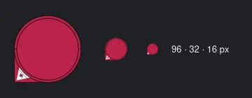  
*Único emblema pronto no projeto: o aro do avatar*

**O que está errado.** O `index.html` aponta para `/vite.svg`, que não existe no projeto. O servidor devolve a página HTML no lugar e a aba mostra o ícone genérico do navegador.

**Por que importa.** É o primeiro detalhe visível na barra do navegador.

**Correção sugerida.** Exportar um favicon (SVG e PNG de 32 e 180 px). O designer escolhe a arte: o emblema existente é o aro do avatar; o “X” verde da logo é outra opção.

**Onde:** `index.html:5`

### Polimento

#### FAV-02 · Título da aba fixo e com outro nome

**Severidade:** Polimento · **Rota:** direto · **Esforço:** P  
**Tela:** Todas as telas

*Sem print: o problema não aparece na área da página.*

**O que está errado.** Toda página se chama “HxH RPG System”, enquanto a logo diz “System X System”. Com várias abas abertas, não dá para distinguir.

**Por que importa.** Consistência de marca e WCAG 2.4.2 (título de página).

**Correção sugerida.** Nome escolhido pelo designer e título por página (“Campanhas · System X System”, “O Grande Início · Mesa”).

**Onde:** `index.html:13`; Nenhuma página define `document.title`

#### FOR-04 · Validação mistura balão do navegador e caixa própria

**Severidade:** Polimento · **Rota:** direto · **Esforço:** P  
**Tela:** Login e cadastro

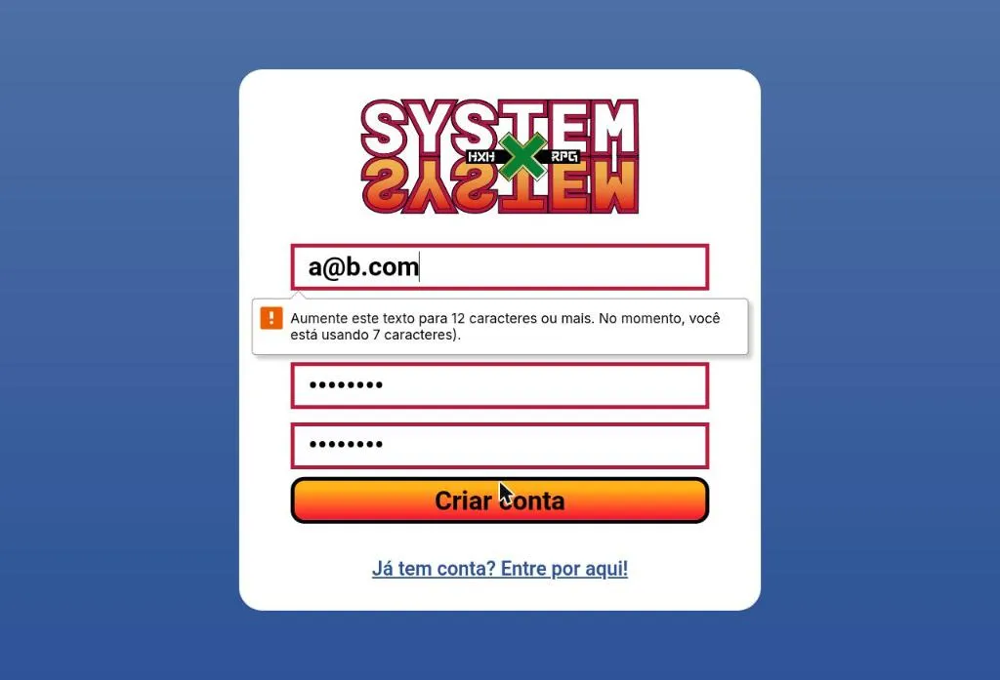  
*“a@b.com” barrado: “Aumente este texto para 12 caracteres”*

**O que está errado.** Campo vazio ou e-mail curto mostram o balão nativo do navegador; erros do servidor aparecem na caixa vermelha do app. O cadastro exige e-mail com 12 ou mais caracteres sem avisar. O login limita a senha a 32 caracteres, mas o back aceita 64 e a mensagem de erro fala em 64.

**Por que importa.** Heurísticas 4 (consistência) e 9 (mensagens de erro).

**Correção sugerida.** `noValidate` no formulário e validação própria na `SignFormError`, em português; dica “mínimo de 12 caracteres” no e-mail (ou rever a regra no back); `maxLength` da senha igual ao do back.

**Onde:** `src/pages/RegisterPage.tsx:51-89 (`minLength={12}` em :57)`; `src/pages/LoginPage.tsx:62-71`; `src/features/auth/authErrorMessages.ts:31`

#### FOR-05 · Login no celular encosta nas bordas

**Severidade:** Polimento · **Rota:** designer decide · **Esforço:** P  
**Tela:** Login e cadastro em 390 px

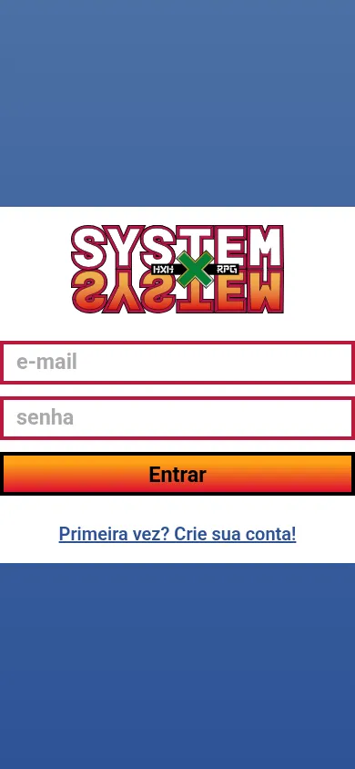  
*390 px: campos e botão tocam as laterais*

**O que está errado.** Abaixo de 480 px o cartão vira uma faixa branca de ponta a ponta, e campos e botão encostam nas laterais da tela.

**Por que importa.** Sem respiro lateral, o layout parece quebrado em telas pequenas.

**Correção sugerida.** Manter 16 px de margem lateral nos campos, ou manter o cartão com cantos. É decisão visual.

**Onde:** `src/components/templates/SignPagesTemplate.tsx:94-101`; `src/components/ions/BaseInput.tsx:165-171`

#### FOR-06 · Campos obrigatórios não marcados

**Severidade:** Polimento · **Rota:** direto · **Esforço:** P  
**Tela:** Criar e editar campanha e partida

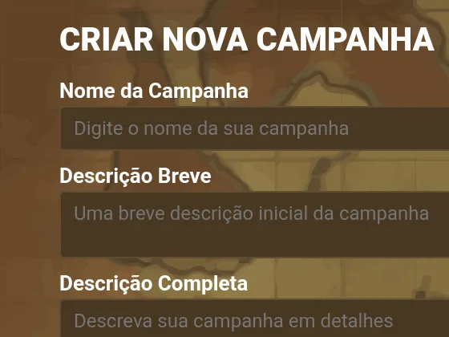  
*Nada distingue obrigatório de opcional*

**O que está errado.** Nada indica que “Nome” e “Descrição breve” são obrigatórios e os outros não; o aviso só vem no balão do navegador, ao enviar.

**Por que importa.** Heurística 5 (prevenção de erro).

**Correção sugerida.** Marcar “(opcional)” nos opcionais (ou “*” nos obrigatórios) no `FormField` e trocar o balão por mensagem própria.

**Onde:** `src/components/molecules/FormField.tsx`; `src/pages/CreateCampaignPage.tsx`; `src/pages/CreateMatchPage.tsx`

#### NAV-02 · Ficha sem cabeçalho e estreita no desktop

**Severidade:** Polimento · **Rota:** designer decide · **Esforço:** M  
**Tela:** Ficha de personagem: ver, criar e editar

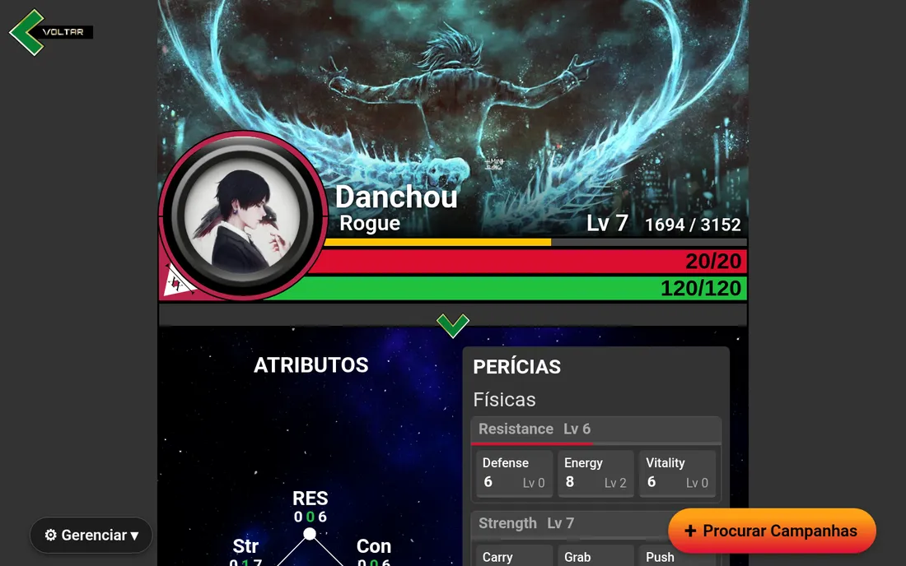  
*1440 px: a ficha ocupa um terço da largura*

**O que está errado.** É a única tela sem a barra com a logo. No desktop, a ficha ocupa um terço da largura, com faixas cinza vazias dos lados, e os botões flutuantes ficam fora da coluna dela.

**Por que importa.** Estrutura diferente das outras telas. Pode ser decisão (a ficha imita um cartão), mas hoje parece um layout de celular no meio da tela.

**Correção sugerida.** Ver com o designer: cabeçalho padrão e fundo temático nas laterais, ou manter e alinhar os botões flutuantes à coluna.

**Onde:** `src/pages/CharacterSheetPage.tsx`; `src/features/sheet/`

#### RES-02 · Abas laterais cobrem o texto no celular

**Severidade:** Polimento · **Rota:** direto · **Esforço:** P  
**Tela:** Campanha, partida, criar e editar · 390 a 1149 px

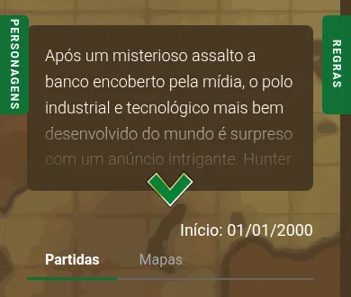  
*390 px: PERSONAGENS e REGRAS sobre a descrição*

**O que está errado.** As abas verticais “PERSONAGENS” e “REGRAS” ficam por cima do conteúdo e têm 32 px de largura.

**Por que importa.** Conteúdo encoberto e alvo de toque abaixo de 44 px.

**Correção sugerida.** Reservar a largura das abas no padding da coluna central e aumentar a área de toque para 44 px (pode ser invisível, sem mudar o desenho).

**Onde:** `src/components/molecules/EdgeDrawer.tsx:65`; `src/components/templates/DetailPageTemplate.tsx:111-122`

#### CON-05 · “+” em ações que não criam nada

**Severidade:** Polimento · **Rota:** direto · **Esforço:** P  
**Tela:** Ficha (+ Ver Campanha, + Procurar Campanhas) e partida (+ Entrar na partida, + Abrir Lobby)

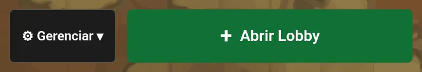  
*“+ Abrir Lobby”*

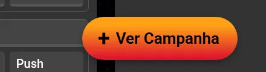  
*“+ Ver Campanha”*

**O que está errado.** O botão flutuante sempre põe o ícone “+”, mesmo quando só navega.

**Por que importa.** O “+” promete criar algo; aqui ele leva para outra tela.

**Correção sugerida.** Ícone como parâmetro (seta para navegar, “+” só para criar) ou sem ícone.

**Onde:** `src/components/molecules/AdaptiveActionButton.tsx:105`; `src/components/molecules/BottomActions.tsx:74, 88`

#### CON-06 · Botões flutuantes por cima de cards e da lista

**Severidade:** Polimento · **Rota:** designer decide · **Esforço:** P  
**Tela:** Campanha (Criar NPC, Gerenciar, Criar Partida) e ficha

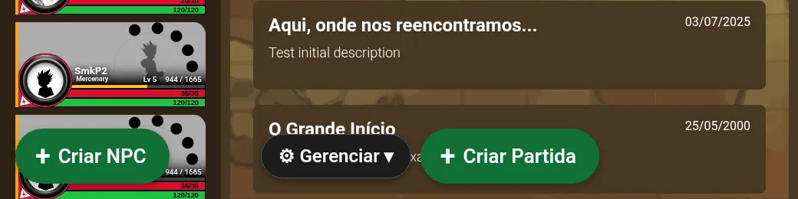  
*Botões sobre um card e sobre a lista de partidas*

**O que está errado.** Em repouso, os botões flutuantes cobrem um card de personagem e o título de uma partida; só saem da frente quando a pessoa rola até o fim.

**Por que importa.** Conteúdo encoberto na primeira impressão da página.

**Correção sugerida.** Faixa com fundo em degradê atrás dos botões, ou espaço extra no fim da lista. É decisão visual.

**Onde:** `src/components/molecules/AdaptiveActionButton.tsx:112-130`; `src/components/molecules/BottomActions.tsx`

#### CON-07 · Excluir: motivo truncado e comportamento diferente entre telas

**Severidade:** Polimento · **Rota:** direto · **Esforço:** P  
**Tela:** Menu Gerenciar da campanha, da partida e da ficha

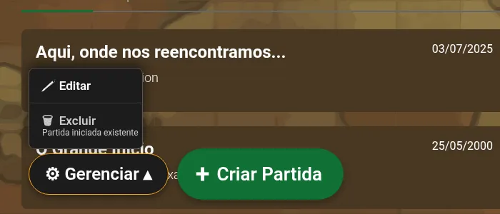  
*“Partida iniciada existente”*

**O que está errado.** Na campanha, Excluir aparece desativado com “Partida iniciada existente”, uma frase incompleta. Na ficha que está numa campanha, Excluir some sem explicação.

**Por que importa.** Heurísticas 4 e 9.

**Correção sugerida.** Texto “Não dá para excluir: há uma partida iniciada.” e o mesmo padrão (desativado com motivo) na ficha.

**Onde:** `src/pages/CampaignPage.tsx:257`; `src/components/molecules/ManageButton.tsx:57-64`

#### CON-08 · “Expulsar” desativado sem explicação

**Severidade:** Polimento · **Rota:** direto · **Esforço:** P  
**Tela:** Lobby · mestre

  
*Jogador não conectado: “Expulsar” apagado*

**O que está errado.** Com o jogador ainda não conectado, “Expulsar” fica apagado, com o texto quase invisível, sem dizer por quê. O botão tem 24 px de altura.

**Por que importa.** Heurística 1 e alvo pequeno.

**Correção sugerida.** Tooltip “Só dá para expulsar quem está conectado” (o `Tooltip` com `aria-disabled` já existe) e 44 px de altura.

**Onde:** `src/features/match/LobbyConnectionSidebarItem.tsx:67-76, 129-147`

#### TXT-03 · Dicas dizem “Toque” também no computador

**Severidade:** Polimento · **Rota:** designer decide · **Esforço:** P  
**Tela:** Mesa e compositor de ação

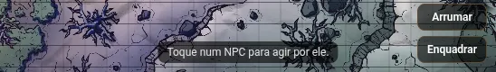  
*“Toque num NPC para agir por ele.” com mouse*

**O que está errado.** “Toque num NPC para agir por ele”, “Toque numa peça para ver a ficha” e as dicas do compositor aparecem iguais quando a pessoa usa mouse.

**Por que importa.** Estranheza pequena numa demonstração em notebook ou projetor.

**Correção sugerida.** Verbo neutro (“Escolha”, “Selecione”) ou “Toque ou clique”. O produto é pensado para tablet, então é decisão de voz.

**Onde:** `src/pages/GameMasterPage.tsx:561-571, 638`; `src/features/match/combat/ActionComposer.tsx:27-29, 151, 196`; `src/features/match/combat/MatchSheetPanel.tsx:17`

#### TXT-04 · “Cena sem nome” e “roleplay” em minúsculas

**Severidade:** Polimento · **Rota:** direto · **Esforço:** P  
**Tela:** Mesa

  
*Topo: “Cena sem nome”*

**O que está errado.** Sem descrição, o topo diz “Cena sem nome”, que parece dado faltando. O histórico mostra “Cena: roleplay” em minúsculas; o diálogo de cena diz “Roleplay”.

**Por que importa.** Consistência de texto.

**Correção sugerida.** Mostrar a categoria quando não há nome (“Cena de roleplay”, “Batalha”) e capitalizar igual em todo lugar.

**Onde:** `src/features/match/combat/MatchTopBar.tsx:50`; `src/features/match/combat/EventStream.tsx:17`; `src/features/match/combat/SceneChangeDialog.tsx:10`

#### TXT-05 · Reticências e rótulos de carregando diferentes

**Severidade:** Polimento · **Rota:** direto · **Esforço:** P  
**Tela:** Todas as telas de carregando

*Sem print: o problema não aparece na área da página.*

**O que está errado.** “Carregando campanhas...” usa três pontos; “Conectando…”, a reticência. A lista de fichas diz só “Carregando...”.

**Por que importa.** Polimento de texto.

**Correção sugerida.** Um padrão (“…”) e rótulos específicos (“Carregando personagens…”).

**Onde:** `src/pages/CharacterSheetsPage.tsx:36`; Demais usos de `LoadingContainer`

#### MESA-04 · Ficha vazia na mesa: uma linha num painel enorme

**Severidade:** Polimento · **Rota:** direto · **Esforço:** P  
**Tela:** Mesa do mestre, painel Ficha sem personagem escolhido

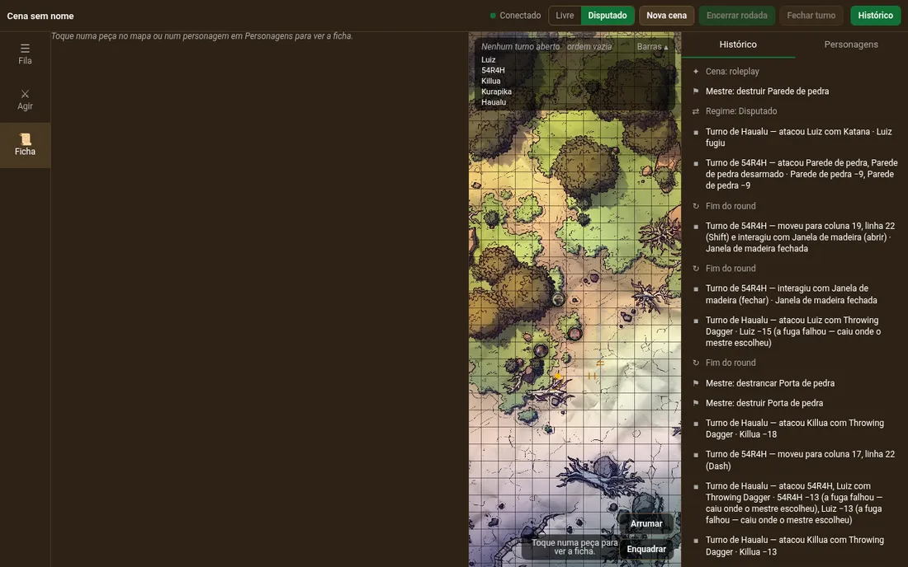  
*Painel largo com uma linha em itálico no canto*

**O que está errado.** O painel ocupa quase metade da tela e mostra só uma linha em itálico no canto superior esquerdo; a mesma dica se repete embaixo do mapa, que encolhe para dar lugar a nada.

**Por que importa.** Estado vazio sem desenho.

**Correção sugerida.** Estado vazio centralizado (ícone e “Toque numa peça ou num personagem para abrir a ficha”) e painel na largura normal até haver ficha.

**Onde:** `src/features/match/combat/MatchSheetPanel.tsx:34`; `src/pages/GameMasterPage.tsx:579, 638`

#### MESA-06 · Cálculo de acerto num turno que é só movimento

**Severidade:** Polimento · **Rota:** direto · **Esforço:** P  
**Tela:** Mesa do mestre · cartão do turno em andamento

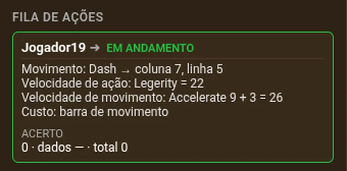  
*Turno só de movimento: “ACERTO 0 · dados — · total 0”*

**O que está errado.** Com um turno de movimento sem ataque aberto, o cartão “EM ANDAMENTO” do mestre mostra o bloco “ACERTO” com “0 · dados — · total 0”.

**Por que importa.** Uma linha vazia com cara de cálculo: quem olha procura um ataque que não existe.

**Correção sugerida.** Mostrar o bloco de acerto só quando a ação tem ataque.

**Onde:** `src/features/match/combat/ResolutionDetails.tsx:84-95`

#### EDI-02 · Editor: nome do mapa sem rótulo

**Severidade:** Polimento · **Rota:** direto · **Esforço:** P  
**Tela:** Criar e editar mapa

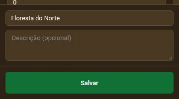  
*Campo com “Floresta do Norte” e nenhum rótulo*

**O que está errado.** O campo do nome mostra só o valor (“Floresta do Norte”), sem rótulo; a descrição só tem placeholder. Abas, campos e botões do painel ficam entre 31 e 40 px de altura.

**Por que importa.** WCAG 3.3.2 e alvos pequenos no tablet.

**Correção sugerida.** Rótulos “Nome do mapa” e “Descrição” e controles com 44 px no tablet.

**Onde:** `src/features/tactical-map/MapEditorToolbar.tsx`; `src/components/templates/MapEditorTemplate.tsx`

#### A11Y-03 · Alvos de toque abaixo de 44 px

**Severidade:** Polimento · **Rota:** direto · **Esforço:** P  
**Tela:** Home (Sair), campanha e partida (abas Partidas e Mapas), formulários (checkbox)

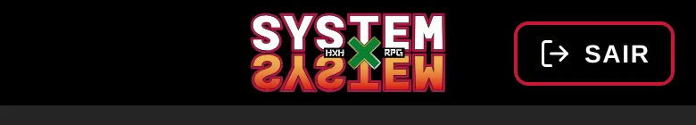  
*390 px: “Sair” com 36 px*

**O que está errado.** “Sair” tem 36 a 40 px de altura, as abas Partidas e Mapas 42 px e o checkbox 24 px. Os outros controles pequenos estão nos próprios achados (CON-04, CON-08, RES-02, EDI-02).

**Por que importa.** WCAG 2.5.5 e a diretriz de toque do projeto para tablet.

**Correção sugerida.** `min-height: 44px` como área de toque, sem mudar o desenho.

**Onde:** `src/components/atoms/LogoutButton.tsx:27`; `src/components/organisms/PageTabNav.tsx`; `src/components/molecules/FormCheckbox.tsx`

#### HALO-01 · Halo dourado na seta Voltar

**Severidade:** Polimento · **Rota:** designer decide · **Esforço:** P  
**Tela:** Cabeçalho de todas as telas com seta

> **Já decidido (26/10):** Seguir a recomendação: halo no hover e, no foco por teclado, só o anel dourado. É provisório: se o designer não gostar, a gente ajusta.

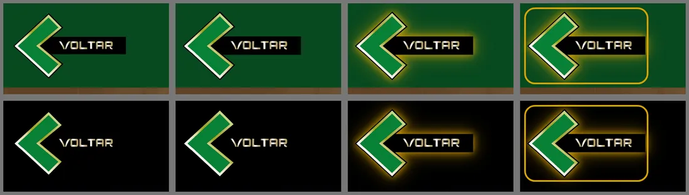  
*Repouso · hover atual · hover com halo · foco por teclado com halo (cabeçalhos verde e preto)*

**O que está errado.** Hoje o hover é só um zoom de 5%, quase imperceptível. Com o halo (pronto e comentado no código desde o merge dos tokens), a seta acende em dourado e o retorno fica claro nos cabeçalhos verde e preto. No foco por teclado, anel dourado e halo juntos ficam carregados. A logo continua só com zoom, porque o halo vazaria entre as letras; são controles diferentes, então a diferença é aceitável.

**Por que importa.** Retorno de hover (heurística 1) e consistência com o anel de foco dourado.

**Correção sugerida.** Recomendação: manter o halo no hover e, no foco por teclado, deixar só o anel (tirar o halo do `:focus-visible`). Ativar é descomentar duas linhas.

**Onde:** `src/components/ions/BackButton.tsx:23-30, 81-82`

## Para a sessão de tokens

Problemas de cor ficam aqui, sem valores propostos: a sessão de tokens decide as cores.

#### COR-01 · Vermelho de erro como borda padrão dos campos

**Severidade:** Importante · **Rota:** tokens · **Esforço:** P  
**Tela:** Login e cadastro

  
*Campos em repouso já com a borda de erro*

**O que está errado.** Os campos têm sempre a borda `redInputError`, a cor de erro; um campo normal parece estar com erro.

**Por que importa.** A mesma cor com dois significados.

**Correção sugerida.** Borda neutra em repouso e o vermelho só no estado de erro.

**Onde:** `src/components/ions/BaseInput.tsx:148`

#### COR-02 · Selo “AGENDADA” com contraste baixo

**Severidade:** Importante · **Rota:** tokens · **Esforço:** P  
**Tela:** Página da partida agendada

  
*Branco sobre o dourado: cerca de 3,3:1*

**O que está errado.** Texto branco sobre o dourado `statusScheduled` dá cerca de 3,3:1 em 13 px; o mínimo é 4,5:1.

**Por que importa.** WCAG 1.4.3.

**Correção sugerida.** Texto escuro sobre o dourado, ou um dourado mais escuro.

**Onde:** `src/features/match/MatchHeaderSection.tsx:112-126`

#### COR-03 · Confirmar exclusão com o laranja do botão principal

**Severidade:** Importante · **Rota:** tokens · **Esforço:** P  
**Tela:** Diálogo de excluir campanha e partida

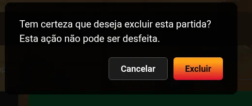  
*“Excluir” no mesmo laranja de “Entrar” e “Criar”*

**O que está errado.** O botão de confirmar a exclusão usa o mesmo degradê laranja de “Entrar” e “Criar”. A regra nova dos tokens pede o vermelho destrutivo intermediário.

**Por que importa.** Uma ação destrutiva com cara de ação principal.

**Correção sugerida.** `actionDestructive` no botão de confirmar.

**Onde:** `src/components/molecules/ManageButton.tsx:79-80`

#### COR-04 · Texto de erro vermelho sobre fundo escuro

**Severidade:** Importante · **Rota:** tokens · **Esforço:** P  
**Tela:** Telas de erro (EST-01)

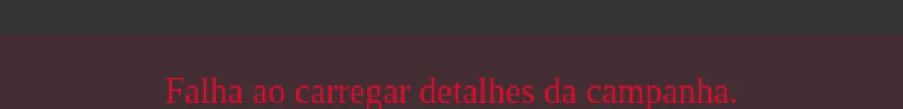  
*Vermelho sobre cinza com véu vermelho: cerca de 2,6:1*

**O que está errado.** `feedbackDanger` sobre o cinza com véu vermelho dá cerca de 2,6:1.

**Por que importa.** WCAG 1.4.3, justamente na mensagem que precisa ser lida.

**Correção sugerida.** Texto claro com faixa ou ícone vermelho, ou o vermelho mais claro que já existe para texto sobre escuro (`actionDestructiveText`).

**Onde:** `src/components/atoms/PageStates.tsx:14-22`

#### COR-05 · Número do HP preto sobre vermelho

**Severidade:** Polimento · **Rota:** tokens · **Esforço:** P  
**Tela:** Barras de HP nos cards e na ficha

  
*Parte do rótulo sobre o preenchimento*

**O que está errado.** A parte do rótulo que fica sobre o preenchimento é preta sobre `vitalHp`: cerca de 4,1:1, abaixo de 4,5:1 nos textos de 10 px (ver MESA-03).

**Por que importa.** WCAG 1.4.3.

**Correção sugerida.** Rever o par de cores do texto sobre o preenchimento.

**Onde:** `src/components/ions/ProgressBar.tsx:125-127`

#### COR-06 · “Lv” cinza na ficha

**Severidade:** Polimento · **Rota:** tokens · **Esforço:** P  
**Tela:** Ficha: perícias e atributos

  
*“Lv 0” em cinza sobre o painel*

**O que está errado.** O cinza claro do “Lv” sobre o painel `#444` dá cerca de 4,2:1 em texto normal de 20 px; o mínimo é 4,5:1.

**Por que importa.** WCAG 1.4.3 (no limite).

**Correção sugerida.** Um cinza um pouco mais claro para texto secundário sobre painéis.

**Onde:** `src/features/sheet/AttributeSkillGroup.tsx:21, 50`

#### COR-07 · Desativados quase invisíveis

**Severidade:** Polimento · **Rota:** tokens · **Esforço:** P  
**Tela:** Lobby (Expulsar), barra do mestre (Encerrar rodada, Fechar turno)

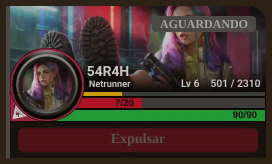  
*“Expulsar” desativado sobre o vermelho escuro*

**O que está errado.** O estado desativado é feito só com opacidade (0,35 a 0,5) sobre fundos escuros, e o texto praticamente some.

**Por que importa.** A WCAG não exige contraste em desativados, mas o mestre precisa ler o rótulo para saber o que vai liberar.

**Correção sugerida.** Um token de desativado com texto legível, em vez de opacidade.

**Onde:** `src/features/match/LobbyConnectionSidebarItem.tsx:143-146`; `src/features/match/combat/MasterControls.tsx`

## Fora do escopo, mas vale saber

- O mapa “Floresta do Norte” tem a marca d’água do artista na imagem (“…ATREON | NEUTRAL PARTY”, no canto inferior esquerdo). Se for usado na apresentação, vale escolher um mapa sem marca ou dar o crédito em algum lugar.
- O PR de tokens (#81) foi mergeado durante a auditoria. O halo da seta, que estava sem commit no checkout principal, entrou nele como linhas comentadas (HALO-01). A fase 2 já pode começar a partir da `main` atual.

## Próximo passo (fase 2)

Quando as decisões voltarem da triagem, a implementação segue nesta sessão, com subagentes fazendo as edições e a verificação no navegador antes de cada PR. Itens “fazer” com rota *direto* viram PRs pequenos por tema, cada um corrigindo a causa e tirando a duplicação que ela gerou:

1. **Estados de espera e erro:** EST-01 a EST-05, PROD-01 e PROD-02. Vai primeiro porque é o que a banca tende a ver. Inclui um PR no back para o `/health` da API, com contrato.
2. **Tipografia:** TIP-01 (Roboto global com fallback do sistema).
3. **Datas** (DAT-01) e **responsividade** (RES-01).
4. **Mesa e editor:** MESA-*, EDI-*.
5. **Formulários, textos e acessibilidade:** FOR-*, TXT-*, A11Y-*.

O halo entra num commit próprio. Itens *Claude Design* ganham um briefing curto cada. Este relatório e os prints entram no primeiro PR.
